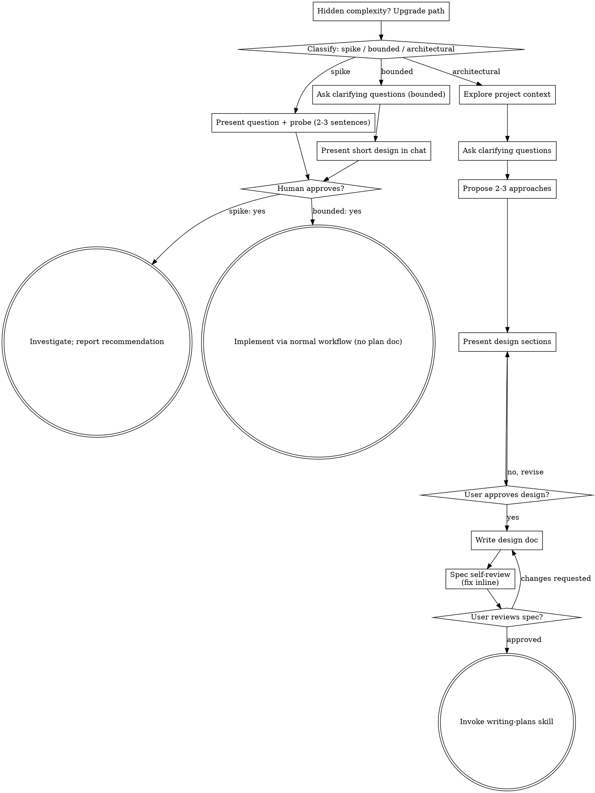

# Dame un prompt para poder hacer un prototipo de nu
_Exported on 08/26/2026 at 20:15:03 GMT-3 from Claude via WayLog_


**User**

Dame un prompt para poder hacer un prototipo de nuestra app para la version mobile y la version pc tambien para el admin. Lo hare con manus ai y le pasare todo el proyecto tambien pero necesito un prompt para que haga el prototippo estilo apple con glassmorphism minimalista aesthetic color blanco como principal y amarillo como secundario, efecto aurora por ejemplo. que tambien tenga login sidebar, header y todo eso. Preguntame lo que necesites

---


**User**

Base directory for this skill: C:\Users\Asus\.claude\plugins\cache\claude-plugins-official\superpowers\6.3.0\skills\brainstorming

# Brainstorming Ideas Into Designs

Help turn ideas into fully formed designs and specs through natural collaborative dialogue.

Start by classifying how much process the request needs, then work
through your path: understand the context, refine the idea, present a
design, and get your human partner's approval.

<HARD-GATE>
Do NOT invoke any implementation skill, write any code, scaffold any
project, or take any implementation action until you have told your
human partner what you intend and they have approved it. This applies
to EVERY task on EVERY path below — the ceremony scales with the task;
the approval gate never does.
</HARD-GATE>

## Three Paths

Before your first question, classify the request and say the
classification out loud — "this looks bounded, so I'll present a short
design here rather than write a spec" — so your human partner can
override it:

- **Spike** — a feasibility question ("can we...", "is it possible...",
  "quick and dirty is fine") whose output is an answer, not code you
  keep. Present the question and what you'll try in 2-3 sentences, get
  a nod, then find out as cheaply as correctness allows. No design
  doc, no spec file. Report findings as a recommendation; anything you
  built stays labeled throwaway.
- **Bounded** — a well-scoped change to code that already exists in
  this repo: a new flag, a small endpoint, a one-file fix.
  Understanding the kind of app is not enough — bounded means the flow
  you are changing is already here to read. If there is no existing
  flow to change, the task is not bounded. Ask the clarifying
  questions that matter, present a short design IN CHAT (a few
  sentences to a few short paragraphs), and STOP. Implementation
  starts only after your human partner says yes to that design — a
  bounded task's approval is as hard a gate as an architectural
  one. No spec file, no implementation plan document.
- **Architectural** — new projects, new subsystems, changes that
  restructure how components fit together or alter interfaces others
  depend on. Follow the full process: questions, approaches, sectioned
  design, written spec, then the writing-plans skill.

When in doubt between two paths, take the heavier one. The ratchet is
one-way: hidden complexity discovered mid-task upgrades the path —
stop, say so, and step up. Nothing downgrades mid-task.

## Anti-Pattern: "Too Simple To Need Approval"

Every path ends with your human partner approving your intent before
implementation. A todo list, a single-function utility, a config
change — the design may be two sentences in chat, but you MUST present
it and get approval. "Simple" tasks are where unexamined assumptions
cause the most wasted work. What scales with simplicity is the
artifact, never the approval.

## Red Flags

| Thought | Reality |
|---------|---------|
| "This is too simple to need a design" | Simple means a short design, not no design. Two sentences in chat, then approval. |
| "I'll call it bounded and skip the spec" | Reaching for a label to skip work IS the doubt — take the heavier path. |
| "It's bounded and the design is obvious — I'll start while they read it" | The gate is the approval, not the design's length. Present, then stop until you hear yes. |
| "I understand this kind of app, so it's bounded" | Bounded measures the repo, not your familiarity. A new project has no existing flow — it is architectural. |
| "The spike works, so I'll keep the code" | A spike's output is an answer. Keeping the code is a new request — classify it. |
| "It grew, but I'm almost done — no need to re-classify" | Hidden complexity upgrades the path mid-task. Stop and say so. |
| "They approved the spike, so the follow-up change is approved too" | Each task gets its own classification and its own approval. |

## Checklist

Classify first, announce the path, then create a task for each item on
your path and complete them in order.

**Spike:**
1. **Explore project context** — enough to frame the probe
2. **Present question + probe plan** — 2-3 sentences
3. **Get approval** — a nod is enough
4. **Investigate** — as cheaply as correctness allows
5. **Report findings** — a recommendation; label anything built as throwaway

**Bounded:**
1. **Explore project context** — check files, docs, recent commits
2. **Ask clarifying questions** — one at a time, the ones that matter
3. **Present short design in chat** — approach, files touched, testing
4. **Get approval** — STOP and wait for an explicit yes; presenting the design and starting in the same breath is skipping the gate
5. **Implement** — proceed with the normal development workflow (TDD applies); no plan document

**Architectural:**
1. **Explore project context** — check files, docs, recent commits
2. **Offer the visual companion just-in-time** — NOT upfront. The first time a question would genuinely be clearer shown than described, offer it then (its own message); on approval its browser tab opens for you. If no visual question ever arises, never offer it. See the Visual Companion section below.
3. **Ask clarifying questions** — one at a time, understand purpose/constraints/success criteria
4. **Propose 2-3 approaches** — with trade-offs and your recommendation
5. **Present design** — in sections scaled to their complexity, get user approval after each section
6. **Write design doc** — save to `docs/superpowers/specs/YYYY-MM-DD-<topic>-design.md` and commit
7. **Spec self-review** — quick inline check for placeholders, contradictions, ambiguity, scope (see below)
8. **User reviews written spec** — ask user to review the spec file before proceeding
9. **Transition to implementation** — invoke writing-plans skill to create implementation plan

## Process Flow



**Terminal states are path-bound.** Architectural: the ONLY skill you
invoke after brainstorming is writing-plans — never frontend-design,
mcp-builder, or any other implementation skill. Bounded: after
approval, implementation proceeds directly through the normal
development workflow; no plan document. Spike: the terminal state is a
reported recommendation.

## The Process

The subsections below serve the bounded and architectural paths (a
spike stops at "present the probe, get a nod"). Sections from
**Exploring approaches** onward are architectural-path depth — for
bounded work, context plus a few questions plus a short in-chat design
is the whole process.

**Understanding the idea:**

- Check out the current project state first (files, docs, recent commits)
- Before asking detailed questions, assess scope: if the request describes multiple independent subsystems (e.g., "build a platform with chat, file storage, billing, and analytics"), flag this immediately. Don't spend questions refining details of a project that needs to be decomposed first.
- If the project is too large for a single spec, help the user decompose into sub-projects: what are the independent pieces, how do they relate, what order should they be built? Then brainstorm the first sub-project through the normal design flow. Each sub-project gets its own spec → plan → implementation cycle.
- For appropriately-scoped projects, ask questions one at a time to refine the idea
- Prefer multiple choice questions when possible, but open-ended is fine too
- Only one question per message - if a topic needs more exploration, break it into multiple questions
- Focus on understanding: purpose, constraints, success criteria

**Exploring approaches:**

- Propose 2-3 different approaches with trade-offs
- Present options conversationally with your recommendation and reasoning
- Lead with your recommended option and explain why
- YAGNI ruthlessly - remove unnecessary features from every approach and design

**Presenting the design:**

- Once you believe you understand what you're building, present the design
- Scale each section to its complexity: a few sentences if straightforward, up to 200-300 words if nuanced
- Ask after each section whether it looks right so far
- Cover: architecture, components, data flow, error handling, testing
- Be ready to go back and clarify if something doesn't make sense

**Design for isolation and clarity:**

- Break the system into smaller units that each have one clear purpose, communicate through well-defined interfaces, and can be understood and tested independently
- For each unit, you should be able to answer: what does it do, how do you use it, and what does it depend on?
- Can someone understand what a unit does without reading its internals? Can you change the internals without breaking consumers? If not, the boundaries need work.
- Smaller, well-bounded units are also easier for you to work with - you reason better about code you can hold in context at once, and your edits are more reliable when files are focused. When a file grows large, that's often a signal that it's doing too much.

**Working in existing codebases:**

- Explore the current structure before proposing changes. Follow existing patterns.
- Where existing code has problems that affect the work (e.g., a file that's grown too large, unclear boundaries, tangled responsibilities), include targeted improvements as part of the design - the way a good developer improves code they're working in.
- Don't propose unrelated refactoring. Stay focused on what serves the current goal.

## After the Design (architectural path)

**Documentation:**

- Write the validated design (spec) to `docs/superpowers/specs/YYYY-MM-DD-<topic>-design.md`
  - (User preferences for spec location override this default)
- Use elements-of-style:writing-clearly-and-concisely skill if available
- Commit the design document to git

**Spec Self-Review:**
After writing the spec document, look at it with fresh eyes:

1. **Placeholder scan:** Any "TBD", "TODO", incomplete sections, or vague requirements? Fix them.
2. **Internal consistency:** Do any sections contradict each other? Does the architecture match the feature descriptions?
3. **Scope check:** Is this focused enough for a single implementation plan, or does it need decomposition?
4. **Ambiguity check:** Could any requirement be interpreted two different ways? If so, pick one and make it explicit.

Fix any issues inline. No need to re-review — just fix and move on.

**User Review Gate:**
After the spec review loop passes, ask the user to review the written spec before proceeding:

> "Spec written and committed to `<path>`. Please review it and let me know if you want to make any changes before we start writing out the implementation plan."

Wait for the user's response. If they request changes, make them and re-run the spec review loop. Only proceed once the user approves.

**Implementation:**

- Invoke the writing-plans skill to create a detailed implementation plan
- Do NOT invoke any other skill. writing-plans is the next step.

## Visual Companion

A browser-based companion for showing mockups, diagrams, and visual options during brainstorming. Available as a tool — not a mode. Accepting the companion means it's available for questions that benefit from visual treatment; it does NOT mean every question goes through the browser.

**Offering the companion (just-in-time):** Do NOT offer it upfront. Wait until a question would genuinely be clearer shown than told — a real mockup / layout / diagram question, not merely a UI *topic*. The first time that happens, offer it then, as its own message:
> "This next part might be easier if I show you — I can put together mockups, diagrams, and comparisons in a browser tab as we go. It's still new and can be token-intensive. Want me to? I'll open it for you."

**This offer MUST be its own message.** Only the offer — no clarifying question, summary, or other content. Wait for the user's response. If they accept, start the server with `--open` so their browser opens to the first screen automatically. If they decline, continue text-only and don't offer again unless they raise it.

**Per-question decision:** Even after the user accepts, decide FOR EACH QUESTION whether to use the browser or the terminal. The test: **would the user understand this better by seeing it than reading it?**

- **Use the browser** for content that IS visual — mockups, wireframes, layout comparisons, architecture diagrams, side-by-side visual designs
- **Use the terminal** for content that is text — requirements questions, conceptual choices, tradeoff lists, A/B/C/D text options, scope decisions

A question about a UI topic is not automatically a visual question. "What does personality mean in this context?" is a conceptual question — use the terminal. "Which wizard layout works better?" is a visual question — use the browser.

If they agree to the companion, read the detailed guide before proceeding:
`skills/brainstorming/visual-companion.md`

---


**Claude**

He mirado el scope del proyecto: **Movii** es un Sistema de Gestión de Envíos y Distribución con tres perfiles (operador logístico, repartidor, cliente final), app móvil en React Native y web en TypeScript + Go + Supabase.

Esto es una tarea acotada: el entregable es un **prompt**, no código. Antes de redactarlo necesito cerrar algunas decisiones.

---


**Claude**

Con eso alcanza. Acá tenés el prompt listo para pegar en Manus AI (adjuntale además el repo del proyecto). Está en español, pensado para dos entregables: **web PC** (operador + admin) y **app React Native / Expo** (repartidor + tracking del cliente).

---

```markdown
# PROMPT PARA MANUS AI — Prototipo "Movii"

## Contexto del proyecto
Adjunto el repositorio completo. "Movii" es un **Sistema de Gestión de Envíos y
Distribución** para una empresa de logística. Leé los apuntes de scope antes de
empezar, en especial:
- `Apuntes/Sprints/Sprint0_scope.md` (alcance funcional, módulos, roles)
- `Apuntes/Sprints/sprint 1 v2.md`

Perfiles de usuario:
- **Operador logístico**: registra envíos, asigna rutas y repartidores, monitorea
  la operación, ve reportes.
- **Repartidor**: consulta sus envíos del día, ve la ruta, actualiza estados,
  registra entregas fallidas, reprograma, confirma entrega con firma/foto.
- **Cliente final**: consulta el estado de un envío por código de guía.

## Qué tenés que construir
Un **prototipo navegable** (sin backend real, con datos mock) compuesto por DOS apps:

### 1. App Web PC — Panel de operador + administración
- Stack: **React + TypeScript + Vite + Tailwind CSS**.
- Layout de escritorio: **sidebar fija a la izquierda + header superior + área de
  contenido**. Responsive hasta tablet (la sidebar colapsa a íconos).
- Navegación real entre pantallas con React Router. Estado y datos desde archivos
  locales (`/src/mock/*.ts`).

### 2. App Mobile — Repartidor + Tracking del cliente
- Stack: **React Native con Expo (expo-router) + TypeScript**.
- Navegación: **stack + bottom tab bar** para el repartidor. El tracking del
  cliente es un flujo aparte accesible sin login (pantalla "Seguir mi envío").
- Datos mock locales, sin llamadas de red.

Entregá ambos proyectos en carpetas separadas (`/web` y `/mobile`) con su
`README` de cómo levantarlas (`npm run dev` / `npx expo start`).

---

## Dirección de diseño (aplicar a AMBAS apps)

Estética **estilo Apple / glassmorphism minimalista aesthetic**. Limpio, mucho
aire, jerarquía tipográfica clara, cero saturación visual.

### Paleta
- **Primario / base**: blanco `#FFFFFF` y grises muy claros (`#F7F7F8`, `#EFEFF2`)
  para fondos y superficies.
- **Secundario / acento**: amarillo `#FFD60A` (variantes `#FFC300` hover,
  `#FFF4CC` fondos suaves). Usar el amarillo con moderación: CTAs, estados
  activos, highlights, badges. Nunca como fondo de página completo.
- **Texto**: `#1C1C1E` (principal), `#6E6E73` (secundario), `#AEAEB2` (terciario).
- **Estados semánticos**: verde `#34C759` (entregado), naranja `#FF9F0A`
  (en camino), rojo `#FF3B30` (no entregado / incidencia), gris `#8E8E93`
  (pendiente).
- Soporte de **modo oscuro** opcional (base `#0A0A0C`, superficies
  `rgba(255,255,255,0.06)`), pero el modo claro es el principal.

### Glassmorphism
- Superficies (cards, sidebar, header, modales, bottom bar) con:
  `background: rgba(255,255,255,0.65)`, `backdrop-filter: blur(24px)`,
  `border: 1px solid rgba(255,255,255,0.5)`,
  `box-shadow: 0 8px 32px rgba(17,17,26,0.08)`.
- Bordes redondeados generosos: `radius` 16–24px en cards, 12px en inputs/botones,
  full en chips/avatares.

### Efecto Aurora
- Fondo global con un **aurora suave**: 2–3 blobs de gradiente (amarillo pálido
  `#FFE98A`, blanco, un toque de lila `#E9E4FF` o celeste `#DDEBFF`) muy
  difuminados (`filter: blur(120px)`), animados con un desplazamiento lento
  (20–30s, `ease-in-out`, infinito). Debe verse detrás del contenido glass,
  sutil, sin distraer. En mobile una versión más liviana (performance).

### Tipografía
- Fuente: **SF Pro / -apple-system**, fallback **Inter**.
- Escala: display 32–40 / título 24 / subtítulo 18 / cuerpo 15–16 / caption 13.
- Pesos: 600 para títulos, 400–500 para cuerpo. Tracking ligeramente negativo en
  títulos grandes.

### Microinteracciones
- Transiciones 150–250ms `ease`. Hover sutil (elevación + leve tinte amarillo).
- Estados de foco visibles (ring amarillo translúcido) por accesibilidad.
- Skeletons glass para estados de carga simulados.

### Componentes globales requeridos
- **Login**: pantalla centrada, card glass sobre el aurora, logo "Movii",
  campos email/contraseña, botón primario amarillo, link "¿Olvidaste tu
  contraseña?", selector de rol solo para el prototipo (Operador / Repartidor).
- **Sidebar** (web): logo arriba, navegación con íconos + label, item activo con
  fondo glass y barra/acento amarillo, footer con avatar + nombre + logout.
  Colapsable.
- **Header** (web): título de sección a la izquierda, buscador global al centro,
  a la derecha: notificaciones, toggle de tema, avatar con menú.
- **Bottom tab bar** (mobile): glass, 4–5 íconos, tab activa en amarillo.
- **Cards, tablas con filtros, badges de estado, timeline de tracking, modales,
  toasts, empty states, paginación.**
- Incluir una página/pantalla **"Design System"** que muestre paleta, tipografía
  y componentes (sirve como estándar de diseño de interfaz de la cátedra).

---

## Pantallas

### WEB PC (Operador + Admin)
1. **Login**
2. **Dashboard / Monitoreo**: KPIs (envíos del día, entregados, en camino,
   fallidos, % cumplimiento), gráfico de envíos por estado, gráfico de entregas
   por zona, lista de incidencias recientes, mapa/placeholder de rutas activas.
3. **Envíos** (listado): tabla con código de guía, remitente, destinatario,
   zona, repartidor, estado, fecha; filtros por estado/zona/fecha/repartidor;
   buscador; acción "Nuevo envío".
4. **Alta de envío** (formulario): datos del remitente, destinatario, dirección
   de entrega, características del paquete (peso, dimensiones, fragilidad),
   observaciones. Validaciones visuales.
5. **Detalle de envío**: datos completos, **timeline de estados**, repartidor y
   ruta asignada, evidencias (firma/foto placeholder), botón reasignar.
6. **Rutas del día**: lista de rutas por zona, cada una con repartidor, cantidad
   de paradas, progreso; detalle de ruta con orden de paradas.
7. **Asignación**: envíos sin asignar → asignar a ruta + repartidor (drag & drop
   o selects).
8. **Repartidores**: listado con estado (en ruta / disponible), entregas hoy,
   tasa de éxito; detalle con historial.
9. **Reportes**: tiempos de entrega promedio, cantidad de envíos por período,
   incidencias por motivo, desempeño por repartidor. Con filtros de fecha y
   export (botón simulado).
10. **Configuración / Perfil**.

### MOBILE (React Native / Expo)

**Flujo Repartidor (con login):**
1. **Login** (con selector de rol para el prototipo).
2. **Mi ruta de hoy**: resumen (X paradas, Y entregadas), lista ordenada de
   paradas con dirección, destinatario, estado; acceso a "ver ruta" (mapa
   placeholder).
3. **Detalle de parada / envío**: datos del envío, botones de acción rápida:
   **En camino**, **Entregado**, **No entregado**.
4. **Confirmar entrega**: captura de **firma digital** (canvas), **foto** de
   evidencia (placeholder de cámara), nombre de quien recibe, confirmar.
5. **Registrar entrega fallida**: selección de motivo (ausente, dirección
   incorrecta, rechazado, otro), nota, foto opcional.
6. **Reprogramar**: elegir nueva fecha/franja horaria.
7. **Historial** de entregas del repartidor.
8. **Perfil**.

**Flujo Cliente (sin login):**
9. **Seguir mi envío**: input de código de guía.
10. **Estado del envío**: timeline visual (registrado → en preparación → en
    camino → entregado / no entregado), datos básicos, fecha estimada, mapa
    placeholder.

---

## Datos mock (realistas del dominio logístico)
Generá datos coherentes en `mock/`:
- **Códigos de guía** formato `MOV-2026-000123`.
- Direcciones argentinas realistas (calles, altura, localidad, CP), zonas tipo
  "Zona Norte", "Centro", "Zona Sur", "Oeste".
- 6–8 repartidores con nombres y apellidos, ~10–20 envíos por repartidor.
- Estados: `pendiente`, `en_camino`, `entregado`, `no_entregado`, con timestamps
  encadenados lógicamente.
- Motivos de fallo reales. Reprogramaciones con fecha futura.
- Reportes con números plausibles (tiempos en horas, tasas 85–97%, etc.).
- Un envío de ejemplo bien documentado para que el flujo de tracking del cliente
  luzca completo (código `MOV-2026-000777`).

---

## Requisitos transversales
- **Responsive** real en web; layouts nativos correctos en mobile (safe areas,
  teclado, scroll).
- **Accesibilidad**: contraste AA, foco visible, labels en inputs, targets ≥44px.
- Código **TypeScript** tipado, componentes reutilizables, sin dependencias
  innecesarias.
- Sin backend, sin variables de entorno, sin auth real: el login solo enruta
  según el rol elegido.
- Entregá: `/web` y `/mobile` funcionando, más un `PROTOTYPE.md` con capturas o
  descripción de cada pantalla y cómo navegar el prototipo.
```

---

Si querés, ajusto el prompt para agregar/quitar pantallas, cambiar el acento a otro tono de amarillo, o incluir wireframes de referencia antes de que se lo pases a Manus.

---
