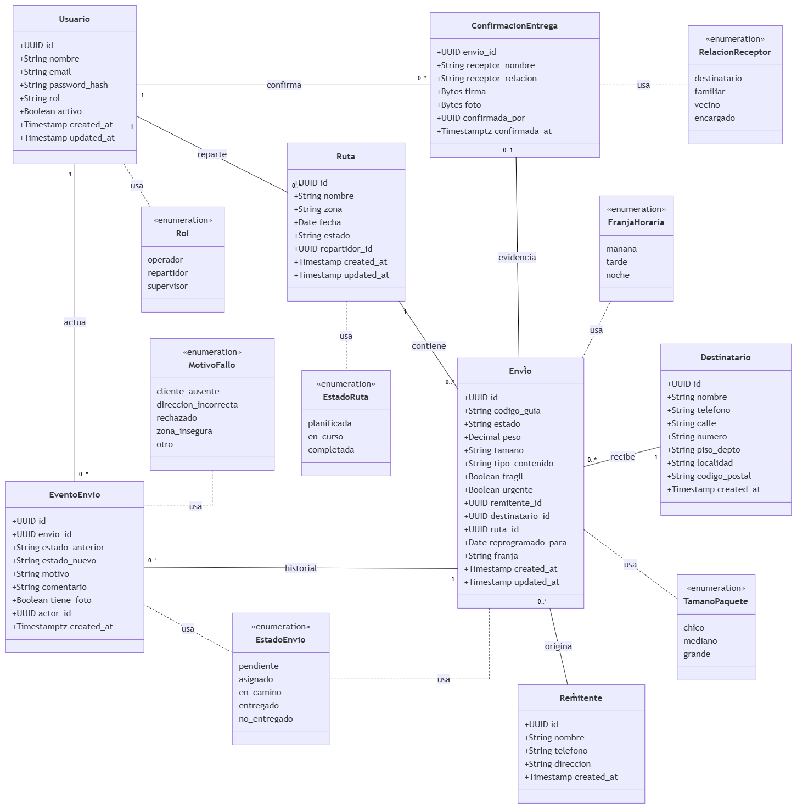
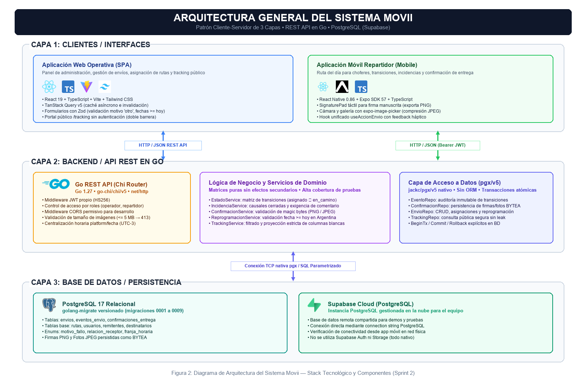
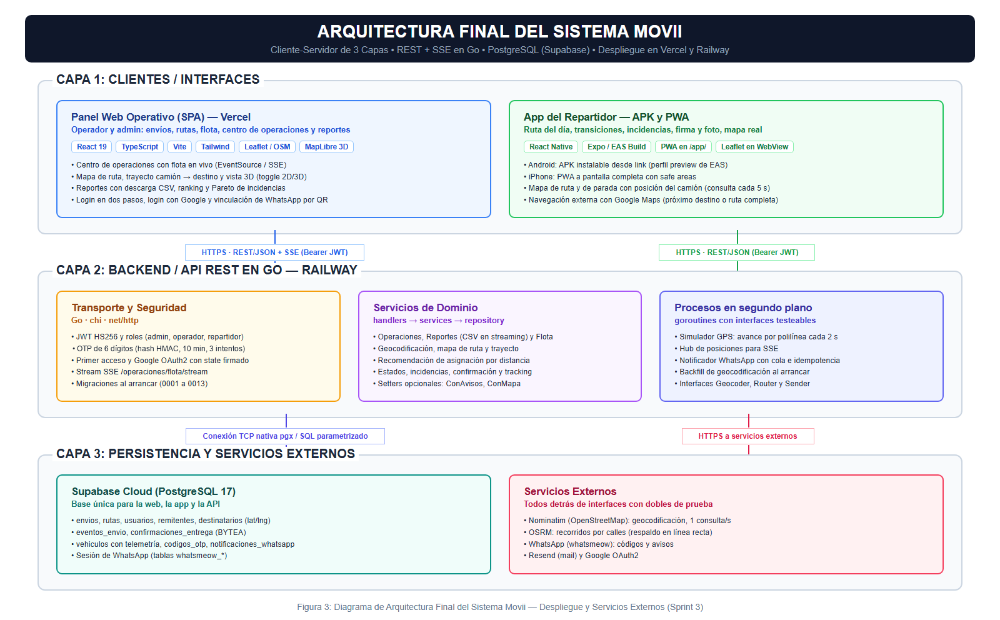

# Trabajo Práctico Integrador — Sprint 3

## Sistema de Gestión de Envíos y Distribución — Movii

**Documento final integrado · Sprints 1, 2 y 3 (HU-01 a HU-19)**

---

**UTN — Facultad Regional San Francisco** · Ingeniería en Sistemas de Información · Ingeniería y Calidad de Software · Año 2026

**Docentes:** Gandino, Diego · Saldarini, Javier Daniel

**Grupo N° 7:** Araya, Ulises · Díaz Aimar, Felipe · Micheloud, Jeremías

**Estado del código descripto:** rama `main`, commit `e9fc789` (07/11/2026, 19:15), más las mejoras posteriores al cierre del 10 y 11/11/2026 (Sprint 3, sección 6.12).

---

# Documento final integrado

## Presentación del documento

Este documento reúne en un solo informe todo lo entregado en el Trabajo Final Integrador: las 19 Historias de Usuario implementadas a lo largo de los tres sprints del proyecto Movii, Sistema de Gestión de Envíos y Distribución.

Cada sprint se presenta en su propia parte, con la misma estructura: objetivo, product backlog, estimaciones, desglose de tareas, modelo de datos, implementación, pruebas, cronograma, Definition of Done y retrospectiva.

- **Sprint 1 (HU-01 a HU-05):** autenticación, registro de envíos, rutas diarias, asignación de envíos y listado del día del repartidor.
- **Sprint 2 (HU-06 a HU-10):** estados de entrega, incidencias, confirmación con firma y foto, reprogramación y tracking público.
- **Sprint 3 (HU-11 a HU-19):** centro de operaciones en vivo, mapas reales, reportes, WhatsApp, flota y app instalable, más las mejoras agregadas en la última semana y lo que quedó fuera del alcance.

## Nota metodológica: tiempos, burndown y reparto del trabajo

1. **Horas "reales" y burndown.** El equipo no llevó una planilla de horas día por día en ninguno de los tres sprints. Las columnas "Real" de las tablas de horas y los valores "reales" de los burndown son una **reconstrucción hecha al cierre de cada sprint** a partir del trabajo efectivamente terminado (funcionalidad verificada, tests y commits). Se presentan para cumplir con el ejercicio de comparar lo estimado contra lo real, no como una medición cronometrada. El burndown se presenta como **tabla**; no se generó un gráfico.
2. **Historial de commits.** Las fechas de los commits no reflejan fielmente el ritmo de trabajo. Parte del desarrollo se consolidó en commits grandes (por ejemplo, la API y la web de HU-06 a HU-10 se integraron el 10/09, y las pantallas móviles del Sprint 2 se reconectaron el 22/10) y varias integraciones se hicieron directamente sobre `main`. El cronograma de cada sprint describe la secuencia de trabajo del equipo; el historial de Git es el respaldo del código, no del calendario.
3. **Responsables.** La columna "Responsable" indica el referente de cada historia. Los tres integrantes trabajaron de forma compartida sobre todas las partes del sistema (API, web y móvil), por lo que la autoría de los commits en Git no se corresponde uno a uno con esa columna.
4. **Revisión por pares.** La revisión se hizo de forma cruzada entre integrantes (revisión conjunta de cambios y merges entre ramas). No se utilizaron Pull Requests formales en todas las integraciones; en la sección de Definition of Done de cada sprint se indica el grado de cumplimiento real.

## Cambios respecto al Sprint 0

El documento del Sprint 0 *originalmente entregado* propuso un stack y un conjunto de herramientas que se ajustaron al implementar (la versión del Sprint 0 que se mantiene en el repositorio ya fue actualizada durante el Sprint 1 y refleja Go y Supabase). La tabla compara lo propuesto en el Sprint 0 original con lo que se entregó efectivamente:

| Aspecto | Propuesto en el Sprint 0 | Entregado | Motivo |
| --- | --- | --- | --- |
| Backend / API | Node.js + Express | **Go + chi** (`handlers → services → repository`) | Binario único, buen rendimiento y concurrencia nativa para el simulador GPS, el stream SSE y el notificador de WhatsApp. |
| Acceso a datos | Prisma (ORM) | **pgx sin ORM**, migraciones SQL con `golang-migrate` | Control explícito de transacciones y de las consultas de reportes y mapas. |
| Base de datos | PostgreSQL 16 local | **PostgreSQL 17 en Supabase** (en el Sprint 2 se usó además un Postgres local en Docker, que se retiró del repositorio en el cierre del proyecto) | Base compartida por el equipo y accesible desde el despliegue. |
| Frontend web | React + Tailwind | React 19 + Vite + TypeScript + Tailwind + TanStack Query + Zod | Se mantiene React + Tailwind; se suma tipado y caché de datos. |
| App móvil | React Native | React Native 0.86 + Expo SDK 57; APK (EAS Build) y PWA | Se mantiene React Native; se agrega distribución instalable (HU-19). |
| Autenticación | JWT | JWT (HS256) + segundo paso por WhatsApp (HU-16) + primer acceso por código + Google OAuth2 | Ampliaciones pedidas por el Product Owner. |
| Documentación de API | Swagger / OpenAPI | `docs/api/openapi.yaml` (OpenAPI 3) | Sin cambios. |
| Despliegue | Railway (backend) + Vercel (frontend) | API en Railway, web y PWA en Vercel, base en Supabase | Sin cambios. |
| Pruebas automatizadas | Jest + Supertest, Cypress (web) y Detox (móvil) | **`go test`** (+ `httptest`) contra PostgreSQL real, **Vitest + React Testing Library** en web y móvil | La API es Go, por lo que Jest/Supertest no aplican; las pruebas de flujo completo se resolvieron con tests E2E de API en Go y pruebas manuales en dispositivos. No se implementaron Cypress ni Detox. |
| Calidad de código | ESLint + Prettier + GitHub Actions | ESLint (web y móvil), `go vet` y tests en GitHub Actions (`api-ci`, `web-ci`, `mobile-ci`) | Sin chequeo de formato automático en el CI. |

## Product Backlog final

| ID | Historia de Usuario | Prioridad | Valor | SP | Sprint | Estado |
| --- | --- | --- | :-: | :-: | --- | --- |
| HU-01 | Registro y autenticación de usuarios | Muy Alta | 8 | 8 | Sprint 1 | Completada |
| HU-02 | Registro de envíos | Muy Alta | 8 | 5 | Sprint 1 | Completada |
| HU-03 | Gestión de rutas diarias | Alta | 5 | 5 | Sprint 1 | Completada |
| HU-04 | Asignación de envíos a ruta | Alta | 5 | 5 | Sprint 1 | Completada |
| HU-05 | Listado de envíos del día para repartidor | Alta | 5 | 3 | Sprint 1 | Completada |
| HU-06 | Actualización de estado de entrega | Alta | 8 | 5 | Sprint 2 | Completada |
| HU-07 | Registro de entrega fallida con motivo | Alta | 5 | 5 | Sprint 2 | Completada |
| HU-08 | Confirmación de entrega con firma y foto | Alta | 5 | 8 | Sprint 2 | Completada |
| HU-09 | Reprogramación de entregas fallidas | Media | 5 | 5 | Sprint 2 | Completada |
| HU-10 | Tracking público por código de guía | Media | 5 | 3 | Sprint 2 | Completada |
| HU-11 | Panel de operaciones en tiempo real | Media | 3 | 5 | Sprint 3 | Completada |
| HU-12 | Visualización de ruta en mapa (ampliada) | Media | 3 | 8 | Sprint 3 | Completada |
| HU-13 | Reportes de envíos por período | Baja | 2 | 3 | Sprint 3 | Completada |
| HU-14 | Ranking de desempeño de repartidores | Baja | 2 | 3 | Sprint 3 | Completada |
| HU-15 | Clasificación de incidencias por motivo | Baja | 2 | 3 | Sprint 3 | Completada |
| HU-16 | Verificación en dos pasos con código por WhatsApp | Media | 3 | 5 | Sprint 3 | Completada |
| HU-17 | Avisos por WhatsApp a destinatarios y repartidores | Media | 5 | 5 | Sprint 3 | Completada |
| HU-18 | Gestión de flota de vehículos | Media | 3 | 5 | Sprint 3 | Completada |
| HU-19 | App del repartidor instalable (APK y PWA) | Alta | 5 | 3 | Sprint 3 | Completada |
| | **Total** | | **87** | **92** | | |

## Resumen por sprint

| Sprint | Período | HU | SP | Horas est. | Horas reales (reconstruidas) | Tests acumulados |
| --- | --- | --- | :-: | :-: | :-: | :-: |
| Sprint 1 | 04/08 – 02/09/2026 (presentación 09/09) | HU-01 a HU-05 | 26 | 197 | 224 | 101 |
| Sprint 2 | 10/09 – 24/09/2026 | HU-06 a HU-10 | 26 | 118 | 130 | 293 |
| Sprint 3 | 01/10 – 07/11/2026 | HU-11 a HU-19 | 40 | 175 | 202 | 437 |
| **Total** | | **19 HU** | **92** | **490** | **556** | |

La columna *Tests acumulados* muestra el total de tests automatizados (API, web y móvil) al cierre de cada sprint. El valor del Sprint 3 corresponde al commit `e9fc789` y se detalla en la sección 6.11 del Sprint 3.

---

# Sprint 1 — HU-01 a HU-05

**Duración del Sprint:** 30 días (04/08/2026 – 02/09/2026) · **Presentación del Backlog:** miércoles 19/08/2026 · **Presentación del Sprint:** miércoles 09/09/2026 (reprogramada; fecha original 02/09/2026)

## 1. Objetivo del Sprint

Implementar las funcionalidades prioritarias del sistema que conforman el **MVP**: registro de envíos, gestión de usuarios y autenticación, asignación de envíos a repartidores y rutas, y consulta del listado de envíos del día por parte del repartidor.

> **Meta:** Al finalizar el sprint, un operador logístico podrá registrar un envío, asignarlo a un repartidor con una ruta, y el repartidor podrá visualizar sus envíos asignados para el día.

**Reparto por interfaz:** HU-01 a HU-04 se implementan en la **aplicación web** (panel del operador logístico / supervisor). HU-05 se implementa en la **app móvil nativa** del repartidor. Ambas interfaces consumen la misma API y comparten la base de datos Supabase. El stack efectivamente utilizado se resume en la sección *Cambios respecto al Sprint 0* de este documento y en 6.1.

---

## 2. Product Backlog priorizado

| ID    | Historia de Usuario                         | Prioridad | Valor | SP | Sprint      |
| ----- | ------------------------------------------- | --------- | :---: | :-: | ----------- |
| HU-01 | Registro y autenticación de usuarios       | Muy Alta  |   8   |  8 | ✅ Sprint 1 |
| HU-02 | Registro de envíos                         | Muy Alta  |   8   |  5 | ✅ Sprint 1 |
| HU-03 | Gestión de rutas diarias                   | Alta      |   5   |  5 | ✅ Sprint 1 |
| HU-04 | Asignación de envíos a ruta                | Alta      |   5   |  5 | ✅ Sprint 1 |
| HU-05 | Listado de envíos del día para repartidor | Alta      |   5   |  3 | ✅ Sprint 1 |
| HU-06 | Actualización de estado de entrega         | Alta      |   8   |  5 | Sprint 2    |
| HU-07 | Registro de entrega fallida con motivo      | Alta      |   5   |  5 | Sprint 2    |
| HU-08 | Confirmación de entrega con firma y foto   | Alta      |   5   |  8 | Sprint 2    |
| HU-09 | Reprogramación de entregas fallidas        | Media     |   5   |  5 | Sprint 2    |
| HU-10 | Tracking público por código de guía      | Media     |   5   |  3 | Sprint 2    |
| HU-11 | Panel de operaciones en tiempo real         | Media     |   3   |  5 | Sprint 3    |
| HU-12 | Visualización de ruta en mapa              | Media     |   3   |  5 | Sprint 3    |
| HU-13 | Reportes de envíos por período            | Baja      |   2   |  3 | Sprint 3    |
| HU-14 | Ranking de desempeño de repartidores       | Baja      |   2   |  3 | Sprint 3    |
| HU-15 | Clasificación de incidencias por motivo    | Baja      |   2   |  3 | Sprint 3    |

Las fichas completas de cada Historia de Usuario (descripción, criterios de aceptación y propiedades) se encuentran detalladas en el documento **Sprint Backlog 1**.

### 2.1 Modificaciones al Product Backlog durante el Sprint 1

Durante la ejecución del Sprint 1 **no se modificó el alcance ni la priorización del Product Backlog**: las 15 HU y su asignación a sprints se mantienen como se presentaron el 19/08. Sí hubo un ajuste de redacción posterior: el 10/09, a pedido del docente en la presentación del Sprint 1, la HU-04 pasó a titularse "Asignación de envíos a ruta" (antes "…a ruta y repartidor"), ya que el repartidor llega a través de la ruta; el código ya funcionaba así (ver Sprint 2, 2.1).

| Fecha | Cambio | HU afectada(s) | Motivo |
| ----- | ------ | -------------- | ------ |
| —     | Sin modificaciones de alcance ni de prioridad durante el sprint | — | — |

---

## 3. Estimaciones de Valor y Esfuerzo

**Escalas utilizadas:**

- **Valor de Negocio:** 1 (soporte) · 2 (útil) · 3 (operativo) · 5 (central) · 8 (imprescindible).
- **Esfuerzo (SP — Fibonacci):** 1 (trivial) · 2 (directo) · 3 (moderado) · 5 (significativo) · 8 (complejo) · 13 (muy complejo).

| ID    | Historia de Usuario                 | Valor | SP | V/E  | Responsable          |
| ----- | ----------------------------------- | :---: | :-: | :--: | -------------------- |
| HU-01 | Registro y autenticación           |   8   |  8 | 1.00 | Micheloud, Jeremías |
| HU-02 | Registro de envíos                 |   8   |  5 | 1.60 | Díaz Aimar, Felipe  |
| HU-03 | Gestión de rutas diarias           |   5   |  5 | 1.00 | Araya, Ulises        |
| HU-04 | Asignación de envíos              |   5   |  5 | 1.00 | Díaz Aimar, Felipe  |
| HU-05 | Listado del repartidor              |   5   |  3 | 1.67 | Araya, Ulises        |
|       | **Total**                           |**31** |**26**|     |                      |

**Capacidad:** 3 integrantes × 30 días × ~2 hs/día = **180 horas** · **Estimado total de tareas:** 197 horas (según el desglose tarea por tarea del Sprint Backlog 1).

> **Nota de capacidad:** la estimación (197 hs) **excede la capacidad (180 hs) en un 9 %**; no hay margen. Se priorizaron HU-01 y HU-02 y se evaluaba en las dailys renegociar alcance si hacía falta. Las horas reales (224) quedaron un 24 % por encima de la capacidad.

---

## 4. Sprint Backlog — Desglose de tareas

> Vista resumida. El desglose canónico tarea por tarea (con fases análisis / diseño / desarrollo / prueba y columnas Estimado y Real) está en el documento **Sprint Backlog 1**. Los subtotales de ambos documentos coinciden.

### HU-01 — Registro y autenticación de usuarios (Micheloud)

| #       | Fase       | Tarea                                                       | Est. (hs) | Real (hs) |
| ------- | ---------- | ----------------------------------------------------------- | :-------: | :-------: |
| T-01.01 | Análisis  | Definir flujo de autenticación (registro, login, roles)    |     2     |           |
| T-01.02 | Análisis  | Especificar endpoints de la API de autenticación           |     2     |           |
| T-01.03 | Análisis  | Definir política de contraseñas y validaciones            |     1     |           |
| T-01.04 | Diseño    | Diseñar modelo de datos tabla usuarios                     |     2     |           |
| T-01.05 | Diseño    | Diseñar interfaz de login y registro de usuarios           |     5     |           |
| T-01.06 | Desarrollo | Crear migración BD + endpoints register/login/users         |    12     |           |
| T-01.07 | Desarrollo | Implementar middleware de autenticación y autorización     |     4     |           |
| T-01.08 | Desarrollo | Implementar pantallas de login y registro en frontend       |     7     |           |
| T-01.09 | Prueba     | Pruebas unitarias + integración + exploratoria             |     8     |           |
|         |            | **Subtotal HU-01**                                          |  **43**   |           |

### HU-02 — Registro de envíos (Díaz Aimar)

| #       | Fase       | Tarea                                                       | Est. (hs) | Real (hs) |
| ------- | ---------- | ----------------------------------------------------------- | :-------: | :-------: |
| T-02.01 | Análisis  | Definir campos, validaciones y formato código de guía      |     5     |           |
| T-02.02 | Diseño    | Diseñar modelo datos (envíos, remitentes, destinatarios) e interfaces |     8     |           |
| T-02.03 | Desarrollo | Crear migraciones + endpoints POST/GET /envios              |    11     |           |
| T-02.04 | Desarrollo | Implementar formulario y lista de envíos en frontend        |     7     |           |
| T-02.05 | Prueba     | Pruebas unitarias + integración + exploratoria             |     7     |           |
|         |            | **Subtotal HU-02**                                          |  **38**   |           |

### HU-03 — Gestión de rutas diarias (Araya)

| #       | Fase       | Tarea                                                       | Est. (hs) | Real (hs) |
| ------- | ---------- | ----------------------------------------------------------- | :-------: | :-------: |
| T-03.01 | Análisis  | Definir campos, estados y endpoints de rutas                |     3     |           |
| T-03.02 | Diseño    | Diseñar modelo datos tabla rutas e interfaz                |     5     |           |
| T-03.03 | Desarrollo | Crear migración + endpoints POST/GET/PUT /rutas            |    11     |           |
| T-03.04 | Desarrollo | Implementar pantalla gestión de rutas en frontend          |     5     |           |
| T-03.05 | Prueba     | Pruebas unitarias + integración + exploratoria             |     6     |           |
|         |            | **Subtotal HU-03**                                          |  **30**   |           |

### HU-04 — Asignación de envíos a ruta (Díaz Aimar)

| #       | Fase       | Tarea                                                       | Est. (hs) | Real (hs) |
| ------- | ---------- | ----------------------------------------------------------- | :-------: | :-------: |
| T-04.01 | Análisis  | Definir reglas de negocio y endpoints de asignación        |     4     |           |
| T-04.02 | Diseño    | Diseñar interfaz de asignación y flujo de selección      |     5     |           |
| T-04.03 | Desarrollo | Implementar endpoints asignación/desasignación + validaciones |    10     |           |
| T-04.04 | Desarrollo | Implementar pantalla de asignación en frontend             |     7     |           |
| T-04.05 | Prueba     | Pruebas unitarias + integración + exploratoria             |     7     |           |
|         |            | **Subtotal HU-04**                                          |  **33**   |           |

### HU-05 — Listado del repartidor (Araya)

| #       | Fase       | Tarea                                                       | Est. (hs) | Real (hs) |
| ------- | ---------- | ----------------------------------------------------------- | :-------: | :-------: |
| T-05.01 | Análisis  | Definir datos, filtrado y endpoint del repartidor           |     2     |           |
| T-05.02 | Diseño    | Diseñar interfaz vista repartidor y resumen del día        |     5     |           |
| T-05.03 | Desarrollo | Implementar endpoint + agrupación por ruta                 |     5     |           |
| T-05.04 | Desarrollo | Implementar vista en app móvil + filtros + resumen         |     9     |           |
| T-05.05 | Prueba     | Pruebas unitarias + exploratoria en dispositivo móvil      |     4     |           |
|         |            | **Subtotal HU-05**                                          |  **25**   |           |

### Tareas transversales

| #       | Tarea                                                                | Responsable | Est. (hs) | Real (hs) |
| ------- | -------------------------------------------------------------------- | ----------- | :-------: | :-------: |
| T-00.01 | Diseñar modelo de datos completo del sprint                         | Equipo      |     4     |           |
| T-00.02 | Configurar proyecto Go (rutas, middleware, conexión BD)             | Micheloud   |     4     |           |
| T-00.03 | Configurar Supabase (proyecto + conexión desde Go)                 | Micheloud   |     3     |           |
| T-00.04 | Configurar React Native con Expo (pantalla base, navegación)       | Araya       |     3     |           |
| T-00.05 | Configurar proyecto web (TypeScript, componentes base, cliente HTTP) | Díaz Aimar |     3     |           |
| T-00.06 | Configurar CI/CD en GitHub Actions (lint + tests)                    | Micheloud   |     2     |           |
| T-00.07 | Documentar endpoints en Swagger/OpenAPI                              | Equipo      |     3     |           |
| T-00.08 | Prueba de integración E2E del flujo completo + code review         | Equipo      |     6     |           |
|         | **Subtotal Transversales**                                           |             |  **28**   |           |

### Resumen de horas

| Grupo                  | Horas Est. |
| ---------------------- | :--------: |
| HU-01 — Autenticación |     43     |
| HU-02 — Envíos        |     38     |
| HU-03 — Rutas         |     30     |
| HU-04 — Asignación   |     33     |
| HU-05 — Repartidor    |     25     |
| Transversales          |     28     |
| **Total Sprint 1**     |  **197**   |

---

## 5. Modelo de Datos

El modelo de datos cubre las necesidades de almacenamiento de las 5 HU del sprint. Se compone de 5 tablas:

**`usuarios`** — id (UUID, PK), nombre, email (UNIQUE), password_hash, rol (operador/repartidor/supervisor), activo, created_at, updated_at.

**`envios`** — id (UUID, PK), codigo_guia (UNIQUE, formato MOV-YYYYMMDD-XXXX), estado (pendiente/asignado/en_camino/entregado/no_entregado), peso, tamano (chico/mediano/grande), tipo_contenido, fragil, urgente, remitente_id (FK), destinatario_id (FK), ruta_id (FK, nullable), created_at, updated_at.

**`remitentes`** — id (UUID, PK), nombre, telefono, direccion, created_at.

**`destinatarios`** — id (UUID, PK), nombre, telefono, calle, numero, piso_depto, localidad, codigo_postal, created_at.

**`rutas`** — id (UUID, PK), nombre, zona, fecha, estado (planificada/en_curso/completada), repartidor_id (FK → usuarios), created_at, updated_at.

**Relaciones:**

```
  usuarios ◄──(1:N)── rutas ◄──(1:N)── envios ──(N:1)──► remitentes
                                           │
                                           └──(N:1)──► destinatarios
```

---

## 6. Implementación

Las 5 HU del sprint están implementadas y funcionando de punta a punta contra una base Supabase real (no es un mock). A continuación se detalla cómo se resolvió cada una, con evidencia tomada del sistema corriendo en este momento.

### 6.1 Arquitectura entregada

- **API REST en Go** (`gestion-envios/services/api`): router `chi`, acceso a datos con `pgx` (sin ORM), capas `handlers → services → repository`. Base de datos PostgreSQL gestionada por Supabase.
- **App móvil nativa** (`gestion-envios/apps/mobile`, Expo + React Native): vista del repartidor, reconectada a la API real (login y "Mi ruta de hoy" con datos reales; el resto de las pantallas del prototipo — confirmar entrega, incidencias, reprogramar — corresponden a HU de Sprint 2/3 y siguen como maqueta).
- Autenticación por JWT propio (HS256) con roles (`operador`, `repartidor`, `supervisor`) validados en cada endpoint protegido.

### 6.2 HU-01 — Registro y autenticación de usuarios

Endpoints: `POST /auth/register`, `POST /auth/login`, `GET /users` (solo `supervisor`).

```
$ curl -X POST localhost:8080/auth/login -d '{"email":"supervisor@movii.demo","password":"Movii2026!"}'
→ 200 { "token": "eyJhbGciOi..." }

$ curl localhost:8080/users -H "Authorization: Bearer <token-supervisor>"
→ 200 [ {"id":"...","nombre":"Ana Supervisora","email":"supervisor@movii.demo","rol":"supervisor","activo":true}, ... ]

$ curl localhost:8080/users -H "Authorization: Bearer <token-repartidor>"
→ 403 {"error":{"code":"rol_no_autorizado","message":"no tenés permisos para esta acción"}}
```

Commits: `4111098`, `daaaeb4`, `678f80c`, `ed418bc`, `974963d`, `82642bf`, `724190a`, `62172e6`, `fbf402b`.

### 6.3 HU-02 — Registro de envíos

`POST /envios` crea remitente, destinatario y envío en una única transacción, y genera el código de guía único (`MOV-YYYYMMDD-XXXX`, con reintento automático ante colisión).

```
$ curl -X POST localhost:8080/envios -H "Authorization: Bearer <token-supervisor>" -d '{
    "remitente": {"nombre": "Depósito Central"},
    "destinatario": {"nombre": "Cliente Doc Test", "calle": "Mitre", "numero": "250", "localidad": "San Francisco", "codigo_postal": "X2400"},
    "paquete": {"peso": 3.5, "tamano": "mediano", "tipo_contenido": "Ropa"}
  }'
→ 201 {"codigo_guia":"MOV-20260907-0001","estado":"pendiente","id":"f2ab3067-...","peso":3.5,"tamano":"mediano"}
```

Commits: `23fc0e4`, `8bdd93e`, `986cdb9`, `567e56a`, `3f25367`, `f1953bc`.

### 6.4 HU-03 — Gestión de rutas diarias

`POST /rutas` crea una ruta en estado `planificada`; solo se puede editar (`PUT`) mientras esté en ese estado.

```
$ curl -X POST localhost:8080/rutas -H "Authorization: Bearer <token-supervisor>" -d '{
    "nombre": "Ruta Documentacion", "zona": "Centro", "fecha": "2026-09-07",
    "repartidor_id": "33333333-3333-3333-3333-333333333333"
  }'
→ 201 {"id":"801eacb2-...","nombre":"Ruta Documentacion","zona":"Centro","fecha":"2026-09-07","estado":"planificada", ...}
```

Commits: `c452bc5`, `9fbd852`, `341ccb8`, `f1953bc`.

### 6.5 HU-04 — Asignación de envíos a ruta

`POST /rutas/{id}/envios` asigna envíos pendientes (valida que la fecha de la ruta no haya vencido); `DELETE /rutas/{id}/envios/{envioId}` desasigna. El detalle de la ruta muestra el peso total y la cantidad de envíos.

```
$ curl -X POST localhost:8080/rutas/801eacb2-.../envios -H "Authorization: Bearer <token-supervisor>" -d '{"envio_ids":["f2ab3067-..."]}'
→ 200 {"asignados":1}

$ curl localhost:8080/rutas/801eacb2-... -H "Authorization: Bearer <token-supervisor>"
→ 200 {"id":"801eacb2-...", ..., "envios":[{"codigo_guia":"MOV-20260907-0001","estado":"asignado", ...}], "peso_total":3.5, "cantidad_envios":1}
```

Commits: `9fbd852`, `341ccb8`, `f1953bc`.

### 6.6 HU-05 — Listado de envíos del día para repartidor

`GET /repartidor/envios-del-dia` identifica al repartidor por el JWT (nunca por un parámetro de la URL, para que uno no pueda pedir los envíos de otro), agrupa por ruta y devuelve el resumen del día.

```
$ curl localhost:8080/repartidor/envios-del-dia -H "Authorization: Bearer <token-repartidor>"
→ 200 {
    "fecha": "2026-09-07",
    "rutas": [{"ruta_id":"801eacb2-...","ruta_nombre":"Ruta Documentacion","envios":[{"codigo_guia":"MOV-20260907-0001","estado":"asignado", ...}]}],
    "total": 1, "pendientes": 0, "asignados": 1, "en_camino": 0, "entregados": 0, "no_entregados": 0
  }

$ curl localhost:8080/repartidor/envios-del-dia -H "Authorization: Bearer <token-operador>"
→ 403 (un operador no puede pedir la vista del repartidor)
```

**App móvil:** la pantalla de login pide email y contraseña reales contra `POST /auth/login`; "Mi ruta de hoy" consume este endpoint y muestra los envíos reales del repartidor logueado (`repartidor@movii.demo`) con pull-to-refresh. Se probó en un iPhone físico vía Expo Go, en la misma red WiFi que la API. La pantalla cubre los criterios de aceptación de la HU así:

| CA | Cómo se resuelve en la app |
| -- | -------------------------- |
| CA-01 | El listado sale del JWT del repartidor logueado: la pantalla nunca manda un id de repartidor. |
| CA-02 | Cada tarjeta muestra destinatario, dirección + localidad, código de guía completo, peso y el badge de estado. |
| CA-03 | Una sección por ruta (`SectionList`), con encabezado y cantidad de envíos cuando el repartidor tiene más de una ruta en el día. |
| CA-04 | Chips de filtro por estado (Todos / Asignados / En camino / Entregados / No entregados) que filtran la lista al instante. |
| CA-05 | Tarjeta de resumen con total, entregados, pendientes y no entregados, más el porcentaje de avance del día. Los contadores describen el día completo y no cambian al aplicar un filtro. |
| CA-06 | Layout mobile-first heredado del prototipo (probado en iPhone, 390×844). |

Commits: `5c75dfb`, `926a7b9`, `618c883`, `ed4ef1e`, `7828f31` (API); `8b02191`, `1980931`, `5b79da1`, `ac9d5a9`, `6278548` (móvil).

### 6.7 Testing

Los tests de la API corren contra una base PostgreSQL (Supabase) real (no hay mocks de base de datos): repositorios, servicios de negocio y handlers, más un test end-to-end por cada bloque de HU que ejercita el flujo completo por HTTP (login → operación → verificación). Se ejecutan con `go test ./... -p 1` (la ejecución en serie evita que dos paquetes toquen la base al mismo tiempo).

| Suite | Tests | Resultado |
| ----- | :---: | --------- |
| API (Go, `services/api`) | 82 | 82 pasan · 0 fallan · 0 se saltean |
| App móvil (vitest, `apps/mobile`) | 19 | 19 pasan (queda 1 salteado: un test de la plantilla del prototipo que no aplica al proyecto) |
| **Total** | **101** | |

Además de los tests automatizados se corrió una batería de pruebas manuales por HTTP sobre la API en funcionamiento, criterio de aceptación por criterio de aceptación (ver 6.8).

Durante la implementación se encontraron y corrigieron **6 bugs reales** gracias a este testing: un import circular en el router, un cast de enum faltante en el alta de usuarios, un timing oracle en el login (la respuesta tardaba distinto según si el email existía o no), un hash de contraseña del seed que no correspondía a la contraseña de la demo, un bug de huso horario en la validación de "fecha vencida" de las rutas, y un test de migraciones que rompía datos de otros paquetes al compartir la misma base.

Ambas suites corren en CI (GitHub Actions): `api-ci.yml` para la API y `mobile-ci.yml` (chequeo de tipos + tests) para la app móvil.

### 6.8 Revisión de cierre del sprint

Antes de dar el sprint por cerrado se volvieron a probar las cinco HU de punta a punta —las cuatro que ya estaban testeadas (HU-01 a HU-04) y la última en terminarse (HU-05)—: se corrieron las dos suites completas y se ejercitó cada criterio de aceptación por HTTP contra la API levantada. La revisión encontró **8 defectos** que no habían aparecido antes. Todos quedaron corregidos y cubiertos con tests de regresión.

| # | HU | Defecto | Corrección |
| - | -- | ------- | ---------- |
| 1 | HU-05 | `GET /repartidor/envios-del-dia` devolvía `"rutas": null` cuando el repartidor no tenía envíos asignados para el día. La app móvil recorre esa lista directamente y rompía: en lugar del estado vacío mostraba "No se pudo cargar la ruta del día", como si fuera un problema de conexión. Es el caso de un repartidor que arranca el día sin asignaciones, o sea el más común a primera hora. | El agrupador devuelve siempre un slice inicializado, así el JSON dice `"rutas": []`. Se aplicó lo mismo a los listados de envíos y de rutas, y el cliente móvil normaliza `null` por las dudas. |
| 2 | HU-04 | La asignación de envíos a una ruta no era atómica: al mandar un lote que mezclaba un envío pendiente con otro ya asignado, la API respondía 409 "uno o más envíos no están pendientes" pero el envío pendiente **quedaba asignado igual**. El operador leía que no se había asignado nada mientras la base decía lo contrario. | El `UPDATE` pasó a correr dentro de una transacción con rollback: la asignación es todo o nada. Además se descartan los ids repetidos y la respuesta informa cuántos envíos se asignaron realmente, en vez de cuántos se pidieron. |
| 3 | HU-05 | La app móvil no agrupaba visualmente por ruta (CA-03): mostraba una lista plana y en el encabezado solo el nombre de la primera ruta. Un repartidor con dos rutas no podía ver dónde terminaba una y empezaba la otra. | La pantalla pasó a `SectionList` con un encabezado por ruta (nombre + cantidad de envíos) cuando hay más de una. |
| 4 | HU-05 | La app móvil no tenía el filtro por estado (CA-04). El endpoint ya aceptaba `?estado=`, pero la interfaz no lo ofrecía. | Se agregaron chips de filtro por estado sobre la lista. El filtro usa el estado real de la API (`asignado`) y no el estado visual del prototipo, que colapsa `asignado` en `pendiente`. |
| 5 | HU-05 | El resumen del día (CA-05) estaba incompleto: no mostraba los no entregados, y el contador rotulado "por visitar" en realidad mostraba el total de envíos. | El resumen muestra total, entregados, pendientes y no entregados. Se calcula sobre el día completo, así que no se mueve al aplicar un filtro. |
| 6 | HU-02 | CA-05 pide que el listado de envíos muestre la fecha de creación, y la respuesta de `GET /envios` no la incluía. | Se agregó `fecha_creacion` al listado y al detalle del envío. |
| 7 | HU-05 | El test `TestRepartidorService_EnviosDelDia` dejaba una fila huérfana en `rutas` en cada corrida: registraba dos `t.Cleanup` separados y, como corren en orden inverso al de registro, intentaba borrar la ruta antes que el envío que la referenciaba; el `DELETE` fallaba por la foreign key y el error se descartaba. Es la fuente de los "datos que hubo que limpiar a mano" que menciona la retrospectiva. | Un único `Cleanup` con el orden de borrado correcto. Verificado: dos corridas completas de la suite ya no dejan filas nuevas. |
| 8 | HU-01 | Dos huecos en la validación del token: el parser aceptaba cualquier algoritmo que el propio token declarara, en vez de exigir HS256 (el único con el que la API firma); y `Login` no miraba el campo `activo`, así que un usuario dado de baja podía seguir entrando. | Se fija HS256 en la validación y se rechaza el login de usuarios inactivos, con el mismo error genérico de siempre para no revelar qué cuentas existen. |

También se unificó el huso horario del código de guía: se calculaba con la hora local de la máquina mientras el resto del sistema usa UTC, así que cerca de la medianoche un envío podía quedar fechado un día distinto al que la API considera "hoy".

---

## 7. Cronograma y Burndown Chart

### Cronograma semanal

| Semana | Período        | Actividades principales                                              |
| :----: | --------------- | --------------------------------------------------------------------- |
|   1    | 04/08 – 10/08  | Análisis y diseño de todas las HU. Modelo de datos. Config proyectos.|
|   2    | 11/08 – 17/08  | Desarrollo HU-01 y HU-02. Migraciones BD. Inicio frontend.          |
|   —    | **19/08**      | **Presentación del Product Backlog y Sprint Backlog**                |
|   3    | 18/08 – 24/08  | Desarrollo HU-03 y HU-04. Pruebas unitarias de HU-01 y HU-02.      |
|   4    | 25/08 – 01/09  | Desarrollo HU-05. Pruebas integración y exploratorias. Documentación.|
|   —    | **09/09**      | **Presentación del Sprint 1 y Retrospectiva** (reprogramada desde 02/09)  |

### Burndown Chart

| Fecha            | SP Ideal | SP Real | Horas Ideal | Horas Real |
| ---------------- | :------: | :-----: | :---------: | :--------: |
| 04/08 (inicio)   |    26    |   26    |     197     |    197     |
| 10/08 (semana 1) |    20    |   21    |     158     |    172     |
| 17/08 (semana 2) |    13    |   15    |     118     |    134     |
| 24/08 (semana 3) |     7    |   10    |      79     |     98     |
| 01/09 (semana 4) |     1    |    3    |      39     |     42     |
| 02/09 (cierre)   |     0    |    0    |       0     |      0     |

*Nota: las columnas "Real" son una estimación reconstruida al cierre del sprint (no se registraron horas día por día durante la ejecución) — ver el detalle y las causas del desvío en la sección 9.*

---

## 8. Criterios del Sprint

### Definition of Done (DoD)

1. Código revisado por al menos un compañero (revisión cruzada; idealmente vía pull request).
2. Código sigue lineamientos de estilo (ESLint + Prettier / gofmt).
3. Funcionalidad probada manualmente con casos positivos y negativos.
4. Pruebas unitarias para lógica de negocio (cobertura mínima 70%).
5. Integrado en la rama principal sin conflictos; CI pasa sin errores.
6. Documentación de API actualizada en Swagger si afecta endpoints.
7. Historia demostrada y aprobada por el equipo en revisión de sprint.
8. Sin bugs de severidad alta o crítica pendientes.

### Convenciones del equipo

- **Ramas:** `feature/HU-XX-descripcion-breve`
- **Commits:** en español, prefijo con ID de tarea (ej: `T-02.03: implementar POST /envios`)
- **Pull Requests:** descripción + checklist de DoD + screenshots si aplica
- **Daily Standup:** comunicación asíncrona por Discord (3 preguntas clásicas)
- **Bugs:** issues en GitHub con etiqueta `bug` y severidad. Alta/crítica bloquea sprint.

> **Nota de cierre del proyecto:** en la práctica el equipo integró directamente sobre `main` (no se usó una rama `develop`) y no todas las integraciones pasaron por Pull Request; la revisión fue cruzada entre integrantes. Se deja constancia para que la DoD no se lea como más estricta de lo que fue.

---

## 9. Retrospectiva — Teórico vs. Real

*Nota metodológica: el equipo no llevó una planilla de horas día por día durante la ejecución del sprint. Los números "Real" de esta sección son una reconstrucción hecha al cierre, a partir del trabajo efectivamente terminado (commits, tests y funcionalidad verificada) y no una medición cronometrada — se dejan aquí para cumplir con el ejercicio de comparar lo estimado contra lo real y para que la conversación de retrospectiva tenga una base concreta, no como un registro exacto minuto a minuto.*

### Resumen por grupo de tareas

| Grupo                  | Estimado (hs) | Real (hs) | Diferencia | Observaciones |
| ---------------------- | :-----------: | :-------: | :--------: | ------------- |
| HU-01 — Autenticación |      43       |    49     |    +6      | El cast de enum, el timing oracle del login y el bug de import circular del router salieron durante el testeo y llevaron tiempo extra de diagnóstico. |
| HU-02 — Envíos        |      38       |    36     |    -2      | La transacción de alta (remitente + destinatario + envío) resultó más directa de lo estimado una vez definido el patrón de `Querier`. |
| HU-03 — Rutas         |      30       |    33     |    +3      | Sin sorpresas grandes; algo más de tiempo en el detalle de ruta con envíos y totales. |
| HU-04 — Asignación   |      33       |    40     |    +7      | El bug de huso horario en "fecha vencida" (UTC vs. hora local) costó una sesión de debugging completa. |
| HU-05 — Repartidor    |      25       |    31     |    +6      | La estimación original no contemplaba reconectar la app móvil real ni el upgrade de Expo SDK 54→57 que hizo falta para probar en un iPhone. |
| Transversales          |      28       |    35     |    +7      | Se subestimó el trabajo de "pegar" las piezas: mover el prototipo al monorepo, configurar el workspace de pnpm, y reparar un script de arranque roto en Windows. |
| **Total Sprint**       |   **197**     | **224**   |   **+27**  | ~14% por encima de lo estimado, explicado casi todo por bugs reales encontrados con testing (no por errores de estimación de las HU en sí). |

### Resumen por integrante

| Integrante           | HU asignadas            | Horas estimadas | Horas reales | Diferencia |
| -------------------- | ----------------------- | :-------------: | :----------: | :--------: |
| Micheloud, Jeremías | HU-01 + Transversales   |       52        |      60      |     +8     |
| Díaz Aimar, Felipe  | HU-02, HU-04 + Transv.  |       77        |      84      |     +7     |
| Araya, Ulises        | HU-03, HU-05 + Transv.  |       68        |      80      |    +12     |
|                      | **Total**               |     **197**     |   **224**    |    **+27** |

### Preguntas de Retrospectiva

**¿Qué salió bien?**
- Testear contra la base Supabase real (nada de mocks de base de datos) hizo que aparecieran bugs que un mock nunca hubiera mostrado: un cast de enum, un timing oracle en el login, un bug de huso horario en "fecha vencida". Encontrarlos ahora, con tests automatizados, salió mucho más barato que encontrarlos en producción.
- La API terminó cubriendo las 5 HU del sprint de punta a punta, verificada con requests reales (no solo "en teoría") y con la app corriendo en un teléfono físico.
- Reusar el diseño visual del prototipo (en vez de rehacerlo) permitió no perder tiempo en pantallas nuevas y enfocar el esfuerzo en conectar datos reales.
- Volver a testear las cinco HU al cierre, en vez de confiar en que las ya cerradas seguían bien, sacó a la luz 8 defectos más (ver 6.8), entre ellos dos serios: la app se rompía con un repartidor sin envíos asignados, y una asignación fallida podía dejar envíos asignados igual.

**¿Qué podemos mejorar?**
- La estimación inicial no contempló el trabajo de integración (reconectar el móvil, actualizar el SDK de Expo, mover el proyecto al monorepo) como una tarea propia — quedó "escondido" dentro de HU-05 y de las transversales, y por eso ahí es donde más se desvió.
- Al no tener una base de datos aislada por desarrollador, corrimos el mismo test suite completo dos veces en paralelo sin querer y eso dejó datos corruptos en Supabase que hubo que limpiar a mano.
- La documentación de "cómo se implementó cada HU" se armó recién al final del sprint, no a medida que se cerraba cada una — cuesta más reconstruir el detalle después que documentarlo en el momento.
- Los tests cubrían bien el camino feliz y muy poco los casos vacíos. El bug más grave del sprint (la pantalla del repartidor rompiéndose cuando no hay envíos) vivía justo ahí: en el día sin datos, que nadie había probado.
- Se dio por cumplida una HU sin recorrer sus criterios de aceptación uno por uno. En HU-05, tres de los seis criterios (agrupar por ruta, filtrar por estado y el resumen del día) estaban resueltos en la API pero no en la pantalla, que es donde el criterio los pide.
- La documentación del sprint describía la app con más funcionalidad de la que tenía ("agrupados por ruta" cuando la lista era plana). Describir a partir del código y no de la intención.

**¿Qué acciones concretas tomamos para el próximo sprint?**
- Agregar al Definition of Done: correr `go test ./... -p 1` (nunca en paralelo con otra corrida) antes de dar por cerrada una tarea que toca la base compartida.
- Sumar una línea explícita de "integración y despliegue" en la tabla de estimación de cada sprint, en vez de darla por incluida en el desarrollo de cada HU.
- Completar la sección de Implementación de a una HU por vez, apenas queda terminada y verificada, no todas juntas al final.
- Sumar al Definition of Done un repaso explícito de los criterios de aceptación de la HU sobre la interfaz que el criterio nombra (si el CA dice "la vista muestra", no alcanza con que el endpoint lo devuelva).
- Escribir, para cada endpoint que devuelve una lista, un test con la lista vacía además del test con datos.
- Correr las dos suites completas (API y móvil) antes de cerrar el sprint, no solo la de la parte que se tocó al final.

---

# Sprint 2 — HU-06 a HU-10

## 1. Objetivo del Sprint

**Duración del Sprint:** 14 días (10/09/2026 – 24/09/2026) · **Presentación del Backlog:** jueves 10/09/2026 · **Cierre definitivo:** jueves 24/09/2026

> **Nota de estado técnico (cierre de desarrollo):** la API en Go, la aplicación web y la aplicación móvil quedaron integradas en la rama `main`, con los flujos de reparto y seguimiento operativos y testeados. El conjunto sumó **293 tests automatizados en verde** (178 en Go, 64 en web, 51 en móvil, +1 salteado).

Implementar el seguimiento completo del ciclo de vida del envío: transiciones de estado durante el reparto, incidencias con motivo y foto, reprogramación de fallidas, confirmación con evidencia auditable y tracking público, con su reflejo en la web operativa y en la app móvil.

> **Meta:** al finalizar el sprint, un repartidor podrá avanzar, fallar, confirmar y reprogramar entregas desde el móvil; el operador lo gestionará desde la web; y el cliente final podrá consultar el estado de su paquete por código de guía sin llamar a la empresa.

**Reparto por interfaz:** HU-06, HU-07 y HU-09 se implementan en **web y móvil** (mismo endpoint, distinta interfaz). HU-08 se confirma desde la **app móvil** (firma + foto) y se visualiza en la **web** (en la web no hay formulario de confirmación: la evidencia queda visible en el detalle). HU-10 se implementa en la **API pública** y en la página pública `/tracking` de la web. Todas las interfaces consumen la misma API y comparten la base de datos.

## 2. Product Backlog priorizado

| ID | Historia de Usuario | Prioridad | Valor | SP | Sprint |
| --- | --- | --- | :-: | :-: | --- |
| HU-01 | Registro y autenticación de usuarios | Muy Alta | 8 | 8 | Sprint 1 (Completada) |
| HU-02 | Registro de envíos | Muy Alta | 8 | 5 | Sprint 1 (Completada) |
| HU-03 | Gestión de rutas diarias | Alta | 5 | 5 | Sprint 1 (Completada) |
| HU-04 | Asignación de envíos a ruta | Alta | 5 | 5 | Sprint 1 (Completada) |
| HU-05 | Listado de envíos del día para repartidor | Alta | 5 | 3 | Sprint 1 (Completada) |
| HU-06 | Actualización de estado de entrega | Alta | 8 | 5 | Sprint 2 (Completada) |
| HU-07 | Registro de entrega fallida con motivo | Alta | 5 | 5 | Sprint 2 (Completada) |
| HU-08 | Confirmación de entrega con firma y foto | Alta | 5 | 8 | Sprint 2 (Completada) |
| HU-09 | Reprogramación de entregas fallidas | Media | 5 | 5 | Sprint 2 (Completada) |
| HU-10 | Tracking público por código de guía | Media | 5 | 3 | Sprint 2 (Completada) |
| HU-11 | Panel de operaciones en tiempo real | Media | 3 | 5 | Sprint 3 |
| HU-12 | Visualización de ruta en mapa | Media | 3 | 5 | Sprint 3 |
| HU-13 | Reportes de envíos por período | Baja | 2 | 3 | Sprint 3 |
| HU-14 | Ranking de desempeño de repartidores | Baja | 2 | 3 | Sprint 3 |
| HU-15 | Clasificación de incidencias por motivo | Baja | 2 | 3 | Sprint 3 |

Las fichas completas de cada Historia de Usuario (descripción, criterios de aceptación y propiedades) se encuentran en el documento **Sprint Backlog 2**.

### 2.1 Modificaciones al Product Backlog durante el Sprint 2

| Fecha | Cambio | HU afectada(s) | Motivo |
| --- | --- | --- | --- |
| 10/09 | HU-04 pasa a titularse "Asignación de envíos a ruta" (antes "…a ruta y repartidor"). Sin cambio de alcance ni de SP. | HU-04 | Corrección del docente en la presentación del Sprint 1: el envío se asigna a la ruta y el repartidor llega vía `rutas.repartidor_id`. |
| 10/09 | Alcance del Sprint 2 confirmado completo, sin recortes. Orden por dependencias: HU-06 → HU-07 → HU-09 → HU-08 → HU-10. | HU-06 a HU-10 | Decisión del equipo: las 5 HU se implementan. |
| 10/09 | Decisiones de diseño cerradas: foto de HU-07 opcional con el mecanismo de HU-08; confirmación directa desde `asignado` registra doble evento; franja de HU-09 obligatoria; tracking solo con columnas blancas; notificación al cliente fuera de alcance. | HU-07, HU-08, HU-09, HU-10 | Cierre de los puntos "a validar" del borrador de fichas. (La notificación al cliente se retoma en HU-17, Sprint 3.) |
| Cierre | Se agrega `fecha_entrega` por envío, fecha de ruta opcional y envíos atrasados en el día del repartidor. | HU-03, HU-05, HU-09 | Validación con datos reales: la fecha rígida de la ruta ocultaba envíos de días anteriores. Sin cambio de alcance (ver 6.10). |
| Cierre | El "hoy" del negocio pasa a hora de Argentina (UTC-3) en API, base y móvil. | HU-05, HU-09, HU-02 | Con UTC, después de las 21 h una fecha de hoy se leía como mañana (ver 6.10). |

## 3. Estimaciones de Valor y Esfuerzo

**Escalas utilizadas:**

- **Valor de Negocio:** 1 (soporte) · 2 (útil) · 3 (operativo) · 5 (central) · 8 (imprescindible).
- **Esfuerzo (SP — Fibonacci):** 1 (trivial) · 2 (directo) · 3 (moderado) · 5 (significativo) · 8 (complejo) · 13 (muy complejo).

| ID | Historia de Usuario | Valor | SP | V/E | Responsable (referente) |
| --- | --- | :-: | :-: | :-: | --- |
| HU-06 | Actualización de estado de entrega | 8 | 5 | 1.60 | Micheloud / Araya |
| HU-07 | Registro de entrega fallida con motivo | 5 | 5 | 1.00 | Díaz Aimar / Araya |
| HU-08 | Confirmación de entrega con firma y foto | 5 | 8 | 0.63 | Díaz Aimar / Araya |
| HU-09 | Reprogramación de entregas fallidas | 5 | 5 | 1.00 | Araya / Díaz Aimar |
| HU-10 | Tracking público por código de guía | 5 | 3 | 1.67 | Micheloud / Araya |
| | **Total Sprint 2** | **28** | **26** | | Equipo completo |

**Capacidad:** 3 integrantes × 14 días × ~2 hs/día = ~84 horas · **Estimado total de tareas:** 118 horas (desglose del Sprint Backlog 2).

> **Nota de capacidad:** la estimación (118 hs) **excede la capacidad (84 hs) en un 40 %**. El margen fue excedido a propósito y declarado desde el backlog (igual que en el Sprint 1) y se sostuvo con trabajo en paralelo (API/web y móvil por separado) y con el avance temprano de la API y la web. Las horas reales (130) quedaron también por encima de la capacidad.

## 4. Sprint Backlog — Desglose de tareas

Horas estimadas y reales (estas últimas reconstruidas al cierre; ver la nota metodológica).

### HU-06 — Actualización de estado de entrega (Micheloud / Araya)

| # | Fase | Tarea | Est. (hs) | Real (hs) | Estado |
| --- | --- | --- | :-: | :-: | --- |
| T-06.01–02 | Análisis | Matriz de transiciones + guards por rol | 3 | 3 | Completada |
| T-06.03–04 | Diseño/Desarrollo | Migración 0003 + EventoRepo + historial en detalle | 7 | 8 | Completada |
| T-06.05–07 | Desarrollo | EstadoService + handler + rutas + wiring | 6 | 6 | Completada |
| T-06.08 | Desarrollo | Acción según estado en móvil | 2 | 2 | Completada |
| T-06.09–10 | Desarrollo/Prueba | Botones + historial en web + E2E | 2 | 3 | Completada |
| | | **Subtotal HU-06** | **20** | **22** | Completada |

### HU-07 — Registro de entrega fallida con motivo (Díaz Aimar / Araya)

| # | Fase | Tarea | Est. (hs) | Real (hs) | Estado |
| --- | --- | --- | :-: | :-: | --- |
| T-07.01–03 | Análisis/Desarrollo | Motivos + RegistrarIncidencia + validaciones | 7 | 7 | Completada |
| T-07.04 | Desarrollo | Foto de incidencia (migración 0005 + GET binario + flag) | 3 | 4 | Completada |
| T-07.05 | Desarrollo | Handler + ruta + mapeo de errores | 2 | 2 | Completada |
| T-07.06 | Desarrollo | Pantalla de incidencia en móvil | 4 | 4 | Completada |
| T-07.07–08 | Desarrollo/Prueba | Form web + Ver foto + E2E | 6 | 7 | Completada |
| | | **Subtotal HU-07** | **22** | **24** | Completada |

### HU-08 — Confirmación de entrega con firma y foto (Díaz Aimar / Araya)

| # | Fase | Tarea | Est. (hs) | Real (hs) | Estado |
| --- | --- | --- | :-: | :-: | --- |
| T-08.01–04 | Análisis/Desarrollo | ConfirmacionRepo + ConfirmarEntrega + matriz + doble evento | 12 | 14 | Completada |
| T-08.05–06 | Desarrollo | Handler POST + 2 GET binarios + metadata en detalle | 5 | 5 | Completada |
| T-08.07 | Desarrollo | Confirmación + signature-pad en móvil | 5 | 6 | Completada |
| T-08.08–09 | Desarrollo/Prueba | Evidencia en web + E2E + 413/magic bytes | 6 | 7 | Completada |
| | | **Subtotal HU-08** | **28** | **32** | Completada |

### HU-09 — Reprogramación de entregas fallidas (Araya / Díaz Aimar)

| # | Fase | Tarea | Est. (hs) | Real (hs) | Estado |
| --- | --- | --- | :-: | :-: | --- |
| T-09.01–05 | Análisis/Desarrollo | Repo + service + handler + validaciones fecha/franja | 11 | 11 | Completada |
| T-09.06 | Desarrollo/Prueba | Detalle + filtro fecha + E2E | 2 | 3 | Completada |
| T-09.07 | Desarrollo | Reprogramación en móvil | 2 | 2 | Completada |
| T-09.08–09 | Desarrollo/Prueba | Form web + "comprometido para" + pruebas | 3 | 3 | Completada |
| | | **Subtotal HU-09** | **18** | **19** | Completada |

### HU-10 — Tracking público por código de guía (Micheloud / Araya)

| # | Fase | Tarea | Est. (hs) | Real (hs) | Estado |
| --- | --- | --- | :-: | :-: | --- |
| T-10.01–04 | Análisis/Desarrollo | Eventos crear/asignar/desasignar + TrackingRepo + mapeo | 8 | 8 | Completada |
| T-10.05 | Desarrollo | Handler + ruta pública | 1 | 1 | Completada |
| T-10.06–07 | Desarrollo/Prueba | Página /tracking + no-leak + E2E ciclo completo | 5 | 6 | Completada |
| | | **Subtotal HU-10** | **14** | **15** | Completada |

### Tareas transversales

| # | Tarea | Responsable | Est. (hs) | Real (hs) | Estado |
| --- | --- | --- | :-: | :-: | --- |
| T-00.01 | Postgres local en Docker + migraciones 0003/0004/0005 | Araya | 3 | 3 | Completada |
| T-00.02 | OpenAPI: 8 endpoints (7 de seguimiento/tracking + GET foto) + schemas | Micheloud | 2 | 3 | Completada |
| T-00.03 | CI verde (`go vet` + tests + ESLint + build) | Micheloud | 2 | 2 | Completada |
| T-00.04 | Rama de integración + revisión cruzada | Equipo | 2 | 2 | Completada |
| T-00.05 | E2E flujo completo + casos vacíos | Araya | 3 | 4 | Completada |
| T-00.06 | Docs de cátedra (backlog + este informe) | Equipo | 2 | 2 | Completada |
| T-00.07 | Contrato API ↔ móvil (DTOs en `openapi.yaml`) | Equipo | 2 | 2 | Completada |
| | **Subtotal transversales** | | **16** | **18** | Completada |

### Resumen de horas por grupo de tareas

| Grupo | Horas est. | Horas reales | Diferencia | Estado |
| --- | :-: | :-: | :-: | --- |
| HU-06 — Actualización de estado | 20 | 22 | +2 | Completada |
| HU-07 — Registro de fallida | 22 | 24 | +2 | Completada |
| HU-08 — Confirmación de entrega | 28 | 32 | +4 | Completada |
| HU-09 — Reprogramación | 18 | 19 | +1 | Completada |
| HU-10 — Tracking público | 14 | 15 | +1 | Completada |
| Tareas transversales | 16 | 18 | +2 | Completada |
| **Total Sprint 2** | **118** | **130** | **+12** | Completada |

El desvío total fue de 12 horas (**+10,2 %**), absorbido por el equipo dentro de las 2 semanas del sprint y motivado por el ajuste riguroso de la validación de magic bytes y la normalización horaria de Argentina.

## 5. Modelo de Datos

El modelo del Sprint 2 amplía el esquema del Sprint 1 para dar soporte a la trazabilidad, la auditoría de eventos y la persistencia de las evidencias de entrega. La **Figura 1** muestra el diagrama de clases y entidad-relación (fuente editable en `gestion-envios/docs/architecture/clases-sprint2.mmd`).



*Figura 1: Diagrama de clases y entidad-relación del Sprint 2.*

### Diccionario de datos del Sprint 2

**Tabla `eventos_envio`** (migraciones 0003 y 0005). Historial inmutable de transiciones y ocurrencias de un envío; es la fuente de auditoría interna y alimenta el tracking público.

| Campo | Tipo | Claves / restricciones | Descripción |
| --- | --- | --- | --- |
| id | UUID | PK, NOT NULL, DEFAULT `gen_random_uuid()` | Identificador del evento. |
| envio_id | UUID | FK → `envios(id)`, ON DELETE CASCADE | Envío sobre el que recae el evento. |
| actor_id | UUID | FK → `usuarios(id)`, ON DELETE SET NULL | Usuario autenticado responsable de la acción. |
| estado_anterior | VARCHAR(30) | NULLABLE | Estado previo (NULL en la creación). |
| estado_nuevo | VARCHAR(30) | NOT NULL | Estado alcanzado. |
| motivo | `motivo_fallo` | NULLABLE | Causal de fallo (obligatoria si `estado_nuevo = 'no_entregado'`). |
| comentario | TEXT | NULLABLE | Detalle (obligatorio cuando `motivo = 'otro'`). |
| foto | BYTEA | NULLABLE | Foto de la visita fallida (JPEG ≤ 5 MB). |
| created_at | TIMESTAMPTZ | NOT NULL, DEFAULT `NOW()` | Fecha y hora UTC del evento. |

**Tabla `confirmaciones_entrega`** (migración 0004). Evidencias formales de la entrega efectiva.

| Campo | Tipo | Claves / restricciones | Descripción |
| --- | --- | --- | --- |
| envio_id | UUID | PK y FK → `envios(id)`, ON DELETE CASCADE | Relación 1:1 con el envío. |
| receptor_nombre | VARCHAR(150) | NOT NULL | Nombre y apellido de quien recibe. |
| receptor_relacion | `relacion_receptor` | NOT NULL | Vínculo del receptor con el destinatario. |
| firma | BYTEA | NOT NULL | Firma manuscrita digitalizada (PNG ≤ 5 MB). |
| foto | BYTEA | NOT NULL | Foto del paquete entregado (JPEG ≤ 5 MB). |
| confirmada_por | UUID | FK → `usuarios(id)`, ON DELETE SET NULL | Repartidor que efectivizó la entrega. |
| confirmada_at | TIMESTAMPTZ | NOT NULL, DEFAULT `NOW()` | Marca temporal UTC de la confirmación. |

**Extensiones sobre `envios`** (migraciones 0004 y 0009).

| Campo | Tipo | Restricciones | Descripción |
| --- | --- | --- | --- |
| reprogramado_para | DATE | NULLABLE | Fecha del próximo intento (≥ hoy). |
| franja | `franja_horaria` | NULLABLE | Franja acordada (`manana`, `tarde`, `noche`). |
| fecha_entrega | DATE | NOT NULL, DEFAULT hoy en Argentina | Fecha de compromiso de reparto (migración 0009). |

> **Nota sobre la Figura 1:** el diagrama de la figura se generó antes de la migración 0009 y no muestra `fecha_entrega` en `Envio`. El atributo está incluido en el diccionario de arriba y en la fuente editable `clases-sprint2.mmd`.

**Tipos enumerados**

| Enum | Valores | Reglas asociadas |
| --- | --- | --- |
| `motivo_fallo` | cliente_ausente, direccion_incorrecta, rechazado, zona_insegura, otro | Catálogo cerrado; con `otro` el comentario es obligatorio. |
| `relacion_receptor` | destinatario, familiar, vecino, encargado | Identificación del receptor para auditoría. |
| `franja_horaria` | manana, tarde, noche | mañana (08:00–12:00), tarde (12:00–18:00), noche (18:00–21:00). |

**Decisión técnica sobre evidencias:** las firmas y fotografías se almacenan como columnas `BYTEA` dentro de PostgreSQL. Esto evita depender de un Object Storage externo y mantiene transacciones atómicas e integridad referencial. Si el volumen lo exige a futuro, se migra a un storage externo conservando las columnas lógicas.

## 6. Implementación

Las funcionalidades del Sprint 2 están implementadas y verificadas de punta a punta contra PostgreSQL (Docker local durante el desarrollo y Supabase en la nube), con paridad garantizada porque las migraciones SQL son las mismas.

### 6.1 Arquitectura entregada

El sistema Movii se estructura en 3 capas desacopladas (**Figura 2**).



*Figura 2: Arquitectura del Sistema Movii — stack tecnológico y componentes (Sprint 2).*

- **Capa 1 — Clientes:** web SPA operativa en React 19 + TypeScript + Vite + Tailwind CSS (TanStack Query y Zod) y app móvil del repartidor en React Native 0.86 + Expo SDK 57 + TypeScript (SignaturePad y `expo-image-picker`).
- **Capa 2 — API REST:** Go **1.27** sobre `go-chi/chi/v5`. Middlewares propios de autenticación JWT (HS256) y CORS; servicios de dominio puros (matrices de estado sin efectos colaterales) y repositorios tipados con `jackc/pgx/v5` sin ORM, con control explícito de transacciones. La **validación del tamaño de las imágenes (≤ 5 MB, `domain.MaxImagenBytes`) se hace en el servicio** y responde HTTP 413.
- **Capa 3 — Base de datos:** PostgreSQL 17 con esquema versionado con `golang-migrate`. En el Sprint 2 las migraciones aplicadas son 0001 a 0005 y 0009; los números 0006 a 0008 quedaron reservados para el Sprint 3 (ver 6.10). En este sprint hubo dos entornos equivalentes: un Postgres local en Docker para desarrollo y pruebas sin internet (retirado del repositorio en el cierre del proyecto) y Supabase Cloud como base remota compartida, que es la que quedó en uso.

### 6.2 HU-06 — Actualización de estado de entrega

Permite la transición controlada del envío durante el reparto (`asignado` ⇄ `en_camino`) y expone el historial cronológico en el detalle.

```
$ curl -X PUT localhost:8080/envios/<id>/estado -H "Authorization: Bearer <token-repartidor>" -d '{"estado":"en_camino"}'
→ 200 {"id":"...","codigo_guia":"MOV-20260910-0001","estado":"en_camino","actualizado_en":"2026-09-10T14:25:00Z"}

$ curl -X PUT localhost:8080/envios/<id>/estado -H "Authorization: Bearer <token-repartidor>" -d '{"estado":"entregado"}'
→ 409 {"error":{"code":"transicion_invalida","message":"usá la confirmación (HU-08) para entregar"}}

$ curl localhost:8080/envios/<id> -H "Authorization: Bearer <token-operador>"
→ 200 {"id":"...","estado":"en_camino","historial":[{"fecha":"...","actor_nombre":"...","estado_anterior":"asignado","estado_nuevo":"en_camino"}]}
```

**Guards:** el repartidor solo opera sobre envíos de sus rutas (JWT); un acceso ajeno devuelve 404 genérico para evitar enumeración. Operador y admin pueden operar sobre cualquier envío no final. El historial vacío se serializa como `[]`, nunca `null`.

### 6.3 HU-07 — Registro de entrega fallida con motivo

```
$ curl -X POST localhost:8080/envios/<id>/incidencia -H "Authorization: Bearer <token-repartidor>" -d '{"motivo":"cliente_ausente"}'
→ 200 {"id":"...","estado":"no_entregado",...}

$ curl -X POST localhost:8080/envios/<id>/incidencia -d '{"motivo":"otro"}'
→ 400 {"error":{"code":"comentario_obligatorio","message":"el comentario es obligatorio cuando el motivo es 'otro'"}}

$ curl localhost:8080/envios/<id>/eventos/<eventoId>/foto -H "Authorization: Bearer <token-operador>"
→ 200 Content-Type: image/jpeg  (bytes originales, ≤ 5 MB)
```

**Reglas:** motivo de catálogo cerrado (5 valores); comentario obligatorio si el motivo es `otro`; foto opcional en JPEG validada por magic bytes (`FF D8 FF`) y de hasta 5 MB. Solo se registra incidencia sobre envíos `asignado` o `en_camino`.

### 6.4 HU-09 — Reprogramación de entregas fallidas

Reincorpora un paquete `no_entregado` al circuito operativo con una nueva fecha y franja.

```
$ curl -X POST localhost:8080/envios/<id>/reprogramacion -H "Authorization: Bearer <token-operador>" -d '{"nueva_fecha":"2026-09-20","franja":"manana"}'
→ 200 {"id":"...","estado":"pendiente","reprogramado_para":"2026-09-20","franja":"manana"}

$ curl -X POST .../reprogramacion -d '{"nueva_fecha":"2026-09-01","franja":"manana"}'
→ 400 {"error":{"code":"fecha_invalida","message":"la fecha de reprogramación debe ser igual o posterior a hoy"}}
```

**Reglas:** solo sobre `no_entregado`; pasa a `pendiente` y se desvincula de la ruta previa (`ruta_id = NULL`); la fecha se valida con la hora de Argentina (UTC-3) y la franja es obligatoria.

### 6.5 HU-08 — Confirmación de entrega con firma y foto

```
$ curl -X POST localhost:8080/envios/<id>/confirmacion -H "Authorization: Bearer <token-repartidor>" \
    -d '{"receptor_nombre":"Juan Pérez","receptor_relacion":"destinatario","firma_base64":"iVBORw0KGgo...","foto_base64":"/9j/4AAQSkZ..."}'
→ 200 {"id":"...","estado":"entregado","actualizado_en":"2026-09-10T16:00:00Z"}

$ curl localhost:8080/envios/<id>/confirmacion/firma -H "Authorization: Bearer <token-operador>"
→ 200 Content-Type: image/png  (bytes idénticos a los enviados)

$ curl -X POST .../confirmacion   (segunda vez)
→ 409 {"error":{"code":"transicion_invalida","message":"..."}}
```

**Reglas:** receptor y relación obligatorios; firma PNG y foto JPEG obligatorias (magic bytes validados, ≤ 5 MB cada una; HTTP 413 si se supera). La confirmación directa desde `asignado` genera un doble evento atómico (`en_camino` + entrega). La clave primaria `envio_id` impide la doble confirmación.

### 6.6 HU-10 — Tracking público por código de guía

Endpoint público (sin login), junto a `/health` y `/auth/*`.

```
$ curl localhost:8080/tracking/MOV-20260910-0001
→ 200 {"codigo_guia":"MOV-20260910-0001","estado":"en_camino","localidad":"San Francisco","actualizado_en":"...",
       "historial":[{"fecha":"...","descripcion":"Envío registrado"},{"fecha":"...","descripcion":"Asignado a ruta de reparto"},{"fecha":"...","descripcion":"En camino a destino"}]}

$ curl localhost:8080/tracking/MOV-20260910-9999
→ 404 {"error":{"code":"no_encontrado","message":"no se encontró ningún envío con ese código"}}
```

**Doble barrera de privacidad:** el repositorio solo proyecta columnas "blancas" (código, estado, localidad, eventos sin actor/comentario/foto) y los tests verifican la ausencia de datos personales (`telefono`, `email`, `calle`, `numero`, `actor_nombre`, `comentario`, `repartidor`, `direccion`). Incluyó completar los eventos que HU-01 y HU-04 no registraban (crear, asignar y desasignar), sin los cuales el tracking de envíos nuevos salía vacío.

### 6.7 Aplicación web operativa (Sprint 2)

| Componente | Ruta / ubicación | Roles | Funcionalidad |
| --- | --- | --- | --- |
| `EnvioDetallePage` | `/envios/:id` | Operador, Admin | Detalle integral: asignación, evidencias e historial. |
| `HistorialTimeline` | detalle y tracking | Operador, Admin, Público | Línea de tiempo con actores, estados y fechas en hora de Argentina. |
| `AccionesEnvio` | detalle | Operador, Admin | Acciones según el estado: iniciar reparto, registrar incidencia, reprogramar. |
| `EvidenciaViewer` | detalle | Operador, Admin | Firma PNG y foto JPEG como blobs temporales con token de sesión (no `` directo). |
| `AsignacionCard` | detalle | Operador, Admin | Vincula Envío ↔ Ruta ↔ Repartidor y permite asignar o cambiar la ruta desde el envío. |
| `TrackingPage` | `/tracking/:codigo` | Público (sin login) | Búsqueda por código, línea de tiempo, 404 amigable, sin datos personales. |

### 6.8 Aplicación móvil del repartidor (React Native / Expo)

- **`SignaturePad`:** lienzo táctil que exporta la firma como PNG válido (magic bytes `89 50 4E 47`).
- **`lib/foto.ts`:** captura con `expo-image-picker` y compresión JPEG automática (≤ 5 MB).
- **`lib/seguimiento.ts`:** catálogos cerrados de motivos, relaciones y franjas; cálculo de fechas en hora de Argentina; validadores previos al envío.
- **`useAccionEnvio`:** mutaciones con estados de carga, feedback háptico y recarga de la lista del día.
- **Pantallas:** envíos del día, historial, perfil, parada (acciones según estado y línea de tiempo), entrega (HU-08), incidencia (HU-07) y reprogramación (HU-09).

### 6.9 Testing y calidad

Los tests se ejecutan en serie (`go test ./... -p 1`) contra bases PostgreSQL reales (Docker y Supabase), sin mocks en los caminos críticos.

| Suite | Entorno y herramientas | Tests | Resultado |
| --- | --- | :-: | --- |
| Backend API | Go · `testing` · `httptest` · PostgreSQL | 178 | 178 pasando |
| Frontend web | Vitest · React Testing Library · TypeScript | 64 | 64 pasando (lint y build limpios) |
| App móvil | Vitest · TypeScript | 51 | 51 pasando (+1 salteado de plantilla) |
| **Total** | | **293** | **100 % verde** |

**Defectos detectados y corregidos en la revisión de cierre (7):**

| # | HU | Defecto | Causa raíz | Solución |
| --- | --- | --- | --- | --- |
| 1 | HU-06 | El historial vacío devolvía `null`. | Slice no inicializado en Go. | Inicialización explícita `make([]Evento, 0)`. |
| 2 | HU-07 | Se aceptaban archivos inválidos. | Validación basada solo en la extensión / MIME del cliente. | Validación de magic bytes (`FF D8 FF` y `89 50 4E 47`). |
| 3 | HU-09 | Se rechazaban fechas válidas después de las 21 h. | El servidor calculaba "hoy" en UTC. | Centralización en `platform/fecha` con hora de Argentina (UTC-3). |
| 4 | HU-09 | Los envíos reprogramados conservaban la ruta previa. | La mutación no limpiaba `ruta_id`. | `ruta_id = NULL` dentro de la transacción. |
| 5 | HU-10 | Fuga de datos personales en el tracking. | La consulta reutilizaba el struct general de envíos. | DTO de proyección estricto `TrackingResponse` + tests negativos. |
| 6 | HU-08 | Timeout con fotos de alta resolución. | Imágenes grandes consumían memoria y tiempo. | Validación de tamaño ≤ 5 MB con HTTP 413 y compresión en el móvil. |
| 7 | HU-05 | Los envíos no entregados desaparecían al día siguiente. | Filtro rígido por la fecha de la cabecera de ruta. | Migración 0009: `fecha_entrega` por envío. |

### 6.10 Ajuste transversal: huso horario y fecha de entrega

Se creó el paquete `internal/platform/fecha`, que centraliza el "hoy" del negocio en hora de Argentina (UTC-3) y se usa en validaciones, día del repartidor, código de guía y valores por defecto de la base (`America/Argentina/Buenos_Aires`). Los eventos del historial siguen guardándose en UTC (`TIMESTAMPTZ`) y se muestran en hora local.

La migración `0009_fecha_entrega` agrega `envios.fecha_entrega` y desacopla la fecha de entrega de la fecha de la ruta: las reprogramaciones no afectan la ruta original, la fecha de la ruta pasó a ser opcional y el día del repartidor incluye los envíos atrasados (`asignado` o `en_camino` con fecha anterior a hoy). **Numeración:** durante el sprint esta migración se creó como `0006`; se renumeró a `0009` para no chocar con las migraciones del Sprint 3 (0006 a 0008), por eso la secuencia del Sprint 2 es 0001–0005 y 0009.

## 7. Cronograma y Burndown Chart

| Período | Hitos y actividades principales |
| --- | --- |
| 10/09 (día 1) | Presentación del Backlog · Postgres Docker · migraciones 0003/0004 · contratos OpenAPI · API de HU-06/07/09/08/10 y web. |
| 11/09 – 17/09 | App móvil (HU-06 a HU-08) · integración web · pruebas cruzadas de interfaces. |
| 18/09 – 23/09 | Revisión integral de cierre · detección y corrección de 7 defectos · suites en serie. |
| 24/09 (cierre) | Cierre definitivo · retrospectiva teórico vs. real · presentación del Sprint 2. |

**Burndown Chart (Story Points)** — tabla; los valores "reales" son una reconstrucción al cierre (ver nota metodológica).

| Fecha | SP ideal | SP real | Observaciones |
| --- | :-: | :-: | --- |
| 10/09 (inicio) | 26 | 26 | Planificación y comienzo de desarrollo. |
| 14/09 (semana 1) | 18 | 21 | Cierre de HU-06 (5 SP). |
| 17/09 (semana 2) | 13 | 16 | Cierre de HU-07 (5 SP). |
| 21/09 (semana 3) | 7 | 8 | Cierre de HU-09 (5 SP) y HU-10 (3 SP). |
| 24/09 (cierre) | 0 | 0 | Cierre de HU-08 (8 SP). 100 % de los SP completados. |

## 8. Criterios del Sprint y Definition of Done (DoD)

Cumplimiento de los 14 ítems de la DoD del sprint:

1. **Revisión por pares:** cumplida mediante revisión cruzada entre integrantes. La integración a `main` se hizo con merges y revisión conjunta; no todas las integraciones pasaron por Pull Request.
2. **Lineamientos de estilo:** cumplida. ESLint sin advertencias en web y móvil y `gofmt` en el código Go.
3. **Pruebas manuales:** cumplida, con casos positivos y negativos en web y móvil.
4. **Pruebas unitarias de negocio:** cumplida con 293 pruebas automatizadas en verde. El porcentaje de cobertura no se midió en este sprint (la medición se incorporó en el Sprint 3).
5. **Integración continua:** cumplida; `api-ci`, `web-ci` y `mobile-ci` activos en GitHub Actions.
6. **Documentación de API:** cumplida; OpenAPI 3 al día con schemas y endpoints.
7. **Demostración y aprobación:** cumplida en la revisión conjunta del equipo.
8. **Sin defectos críticos abiertos:** cumplida; 0 incidencias bloqueantes pendientes.
9. **Ejecución en serie:** cumplida; `go test ./... -p 1`.
10. **Test de colecciones vacías:** cumplida; los arrays vacíos se serializan como `[]`.
11. **Validación de criterios de aceptación:** cumplida sobre las interfaces reales de destino.
12. **Suites completas en verde:** cumplida con 293 tests pasando.
13. **Documentación de historias:** cumplida en este informe y en el Sprint Backlog 2.
14. **Línea de integración transversal:** cumplida con 18 horas dedicadas a tareas de base e infraestructura.

## 9. Retrospectiva — Análisis teórico vs. real

| Grupo | Estimado (hs) | Real (hs) | Diferencia | Observaciones |
| --- | :-: | :-: | :-: | --- |
| HU-06 — Actualización de estado | 20 | 22 | +2 | La matriz pura agilizó el servicio; tiempo extra en la sincronización con TanStack Query. |
| HU-07 — Registro de incidencias | 22 | 24 | +2 | Gestión de fotos JPEG y guard binario requirieron iteraciones adicionales. |
| HU-08 — Confirmación con firma y foto | 28 | 32 | +4 | Diseño del `SignaturePad`, validación de magic bytes y manejo del doble evento. |
| HU-09 — Reprogramación | 18 | 19 | +1 | Desvinculación de la ruta previa y consolidación del huso horario de Argentina. |
| HU-10 — Tracking público | 14 | 15 | +1 | Doble barrera de privacidad con DTOs específicos y pruebas negativas. |
| Tareas transversales | 16 | 18 | +2 | Postgres local en Docker, paridad con Supabase y pipelines de CI. |
| **Total Sprint 2** | **118** | **130** | **+12** | Desvío de +10,2 %, absorbido dentro del plazo del sprint. |

| Integrante | Historias y módulos | Horas est. | Horas reales | Diferencia |
| --- | --- | :-: | :-: | :-: |
| Micheloud, Jeremías | HU-06, HU-10 + transversales (CI, OpenAPI) | 38 | 41 | +3 |
| Díaz Aimar, Felipe | HU-07, HU-08 (móvil) + transversales (web) | 42 | 46 | +4 |
| Araya, Ulises | HU-08 (backend), HU-09 + transversales (infraestructura) | 38 | 43 | +5 |
| **Total** | | **118** | **130** | **+12** |

### Seguimiento de las 6 acciones comprometidas en el Sprint 1

1. `go test ./... -p 1` (en serie, nunca en paralelo): **cumplida**. Todas las corridas de la API se hicieron en serie.
2. Línea de integración explícita en la estimación: **cumplida** (16 hs presupuestadas, 18 reales).
3. Documentar cada HU al cerrarla: **cumplida en gran medida**; OpenAPI y contratos se actualizaron junto con el código.
4. Repasar CAs sobre la interfaz que los nombra: **cumplida** en web y móvil.
5. Test de lista vacía en cada endpoint: **cumplida** (historial `[]`, tracking inexistente 404, listados sin envíos).
6. Suites completas antes de dar por cerrado: **cumplida** (API 178, web 64, móvil 51).

### Preguntas de retrospectiva

**¿Qué salió bien?**
- Levantar PostgreSQL local en Docker permitió desarrollar y testear sin internet y sin ensuciar la base compartida con datos de prueba.
- Definir OpenAPI y las matrices de estado antes de las pantallas permitió que web y móvil avanzaran en paralelo con el backend sin retrabajo.
- La revisión de cierre con las suites completas sacó a la luz 7 defectos reales (por ejemplo, archivos corruptos aceptados por validar solo la extensión), corregidos con tests de regresión.
- Guardar firmas y fotos como `BYTEA` evitó configurar un storage externo y dio transacciones atómicas simples.

**¿Qué podemos mejorar?**
- **Huso horario:** el problema de fechas del Sprint 1 se repitió (UTC vs. Argentina) y se centralizó a último momento en `platform/fecha`; debió definirse desde el día 1.
- **Fecha rígida de la ruta:** ocultaba paquetes no entregados; hubo que agregar `fecha_entrega` por envío (migración 0009).
- **Permisos de GitHub** al inicio: los primeros días hubo errores 403 al pushear ramas, lo que demoró las integraciones.
- **Peso de las imágenes en base64:** infla el tamaño un 33 %. La API valida el tamaño (≤ 5 MB) y responde 413, pero lo hace después de recibir y decodificar el cuerpo; una mejora pendiente es limitar el cuerpo de la petición (`http.MaxBytesReader`) antes de decodificar, y comprimir de forma adaptativa en el móvil.

**Acciones para el Sprint 3**
1. Usar `internal/platform/fecha` en toda fecha nueva (dashboard y reportes).
2. Spike técnico de mapas antes de codificar (HU-12).
3. Compresión adaptativa de imágenes en el cliente móvil.
4. Tests de la API en serie y un seed limpio para los datos analíticos.

---

# Sprint 3 — HU-11 a HU-19

## 1. Objetivo del Sprint

**Duración del Sprint:** 38 días (01/10/2026 – 07/11/2026) · **Presentación del Backlog:** jueves 01/10/2026 · **Cierre definitivo:** sábado 07/11/2026

> **Nota de estado técnico (cierre de desarrollo):** las HU-11 a HU-19 están integradas en la rama `main` y desplegadas (web en Vercel, API en Railway, base en Supabase). El último commit del sprint es `e9fc789` (07/11, 19:15).

Cerrar el producto: dar al administrador y al operador la visión de la operación en vivo y a la gerencia los reportes para decidir, comunicar los cambios de estado por WhatsApp y dejar la app del repartidor instalable en los teléfonos, con todo el sistema desplegado.

> **Meta:** al finalizar el sprint, el administrador verá en un centro de operaciones cada camión con su carga moviéndose en un mapa real; la gerencia podrá exportar reportes, ranking y Pareto de incidencias; el login pedirá un código por WhatsApp; el destinatario recibirá avisos con su link de seguimiento; y el repartidor podrá instalar la app como APK (Android) o PWA (iPhone).

**Reparto por interfaz:** HU-11, HU-13, HU-14, HU-15 y HU-18 se implementan en la web (vistas del operador y del administrador). HU-12 y HU-16 se implementan en web y móvil. HU-17 vive en la API (cola de avisos) con su registro visible en la web. HU-19 es propia de la app del repartidor (APK y PWA). Todas las interfaces consumen la misma API y comparten la base de datos.

> **Nota de roles:** en el Sprint 3 el rol `supervisor` pasó a llamarse `admin` (migración 0010). Donde los Sprints 1 y 2 dicen "supervisor", el sistema actual usa `admin`.

## 2. Product Backlog priorizado

| ID | Historia de Usuario | Prioridad | Valor | SP | Sprint |
| --- | --- | --- | :-: | :-: | --- |
| HU-01 a HU-05 | Autenticación, envíos, rutas, asignación, listado del día | Muy Alta / Alta | 31 | 26 | Sprint 1 (Completadas) |
| HU-06 a HU-10 | Estados, incidencias, firma y foto, reprogramación, tracking | Alta / Media | 28 | 26 | Sprint 2 (Completadas) |
| HU-11 | Panel de operaciones en tiempo real | Media | 3 | 5 | Sprint 3 (Completada) |
| HU-12 | Visualización de ruta en mapa (ampliada) | Media | 3 | 5 → 8 | Sprint 3 (Completada) |
| HU-13 | Reportes de envíos por período | Baja | 2 | 3 | Sprint 3 (Completada) |
| HU-14 | Ranking de desempeño de repartidores | Baja | 2 | 3 | Sprint 3 (Completada) |
| HU-15 | Clasificación de incidencias por motivo | Baja | 2 | 3 | Sprint 3 (Completada) |
| HU-16 | Verificación en dos pasos con código por WhatsApp (nueva) | Media | 3 | 5 | Sprint 3 (Completada) |
| HU-17 | Avisos por WhatsApp a destinatarios y repartidores (nueva) | Media | 5 | 5 | Sprint 3 (Completada) |
| HU-18 | Gestión de flota de vehículos (nueva) | Media | 3 | 5 | Sprint 3 (Completada) |
| HU-19 | App del repartidor instalable, APK y PWA (nueva) | Alta | 5 | 3 | Sprint 3 (Completada) |

Las fichas completas de cada Historia de Usuario se encuentran en el documento **Sprint Backlog 3**. Desde el 11/11 las paradas de cada ruta se ordenan solas por el recorrido más corto (antes las definía el operador por orden de alta); repartir los envíos entre vehículos con franjas y capacidad sigue fuera de alcance (sección 10).

### 2.1 Modificaciones al Product Backlog durante el Sprint 3

| Fecha | Cambio | HU afectada(s) | Motivo |
| --- | --- | --- | --- |
| 22/10 | Primera implementación de HU-11 a HU-15 en la rama `Sprint3`. | HU-11 a HU-15 | Avance del sprint. |
| 04/11 | Se revierte esa implementación de `main` y se conserva en la rama `Sprint3`. | HU-11 a HU-15 | Había quedado sobre una base anterior a las mejoras del 04/11 (pestaña Repartidores, asignación envío–ruta–repartidor, panel del repartidor servido en `/app`). |
| 05–07/11 | Se reintegran HU-11 a HU-15 sobre `main`: analítica y reportes de la rama `Sprint3` más la vista de flota del segundo intento, comparando ambas versiones corriendo en local. | HU-11 a HU-15 | Quedarse con lo mejor de las dos implementaciones sin perder lo del 04/11. |
| 07/11 | HU-12 ampliada (5 → 8 SP): mapa real con recorrido por calles (OSRM), geocodificación (Nominatim) y camiones en vivo con GPS simulado. | HU-12 | Pedido del Product Owner. No es optimización de rutas: el orden de paradas lo define el operador. |
| 07/11 | Alta de HU-16 (login en dos pasos por WhatsApp) y HU-17 (avisos por WhatsApp). | HU-16, HU-17 | Pedido del Product Owner. HU-17 retoma la notificación al cliente excluida en HU-09 (10/09). |
| 07/11 | Alta de HU-18 (flota de vehículos). | HU-18 | La vista del camión con su carga necesita vehículos con capacidad y asignación a la ruta del día. |
| 07/11 | Alta de HU-19 (APK + PWA). | HU-19 | La app solo se probaba en Expo Go; hacía falta poder instalarla. |
| 07/11 | Mejoras agregadas en la última semana (T1 a T6): primer acceso con código, login con Google, rol admin y borrado, recomendación por distancia, vista 3D y navegación con Google Maps, filtros y buscadores. | HU-01, HU-04, HU-12, HU-18 | Pulido final pedido por el Product Owner para la demo. No suman SP: se documentan en 6.9. |
| 07/11 (tarde) | Mejoras de cierre (T7): tracking público en vivo con mapa y hora estimada, perfil del repartidor, 3D en operaciones y cambio de contraseña. | HU-10, HU-12, HU-01 | Pulido final de la demo. No suman SP: se documentan en 6.9. |
| 10/11 | Prueba manual completa de la web (37 hallazgos) y corrección de los graves. | Todas | Verificar los criterios de aceptación en el sistema corriendo antes de la presentación. |
| 11/11 | Recorrido más corto: las paradas se ordenan solas (reemplaza "el orden lo define el operador"). | HU-12 | El recorrido en orden de alta iba y volvía por la ciudad (14,5 km contra 8,6 km). Decisión en `docs/decisions/orden-de-rutas.md`. No suma SP. |
| 11/11 | "Iniciar ruta" reemplaza "Marcar en camino" envío por envío; una ruta iniciada no admite envíos nuevos; el estado de la ruta se deriva de sus envíos. | HU-06, HU-03 | El camión sale del depósito con todos los paquetes y las rutas quedaban siempre "planificadas". El endpoint de HU-06 se mantiene. No suma SP. |
| 11/11 | Avisos formales sin emojis y respaldo por mail. | HU-17 | Pedido del Product Owner. No suma SP. |
| 11/11 | Simulación de un día de trabajo: entregas simuladas, botón ▶ de estado inicial y seguimiento en vivo integrado. | HU-11, HU-12 | Mostrar la operación completa en la presentación sin preparar datos a mano. No suma SP. |
| 11/11 | Rutas y repartidores sugeridos al asignar, vehículos camioneta y auto, "Mis pedidos" en la app y ficha completa del envío. | HU-04, HU-05, HU-18 | Pulido del equipo para la presentación. No suma SP. |

## 3. Estimaciones de Valor y Esfuerzo

**Escalas utilizadas:** Valor de negocio 1 (soporte) · 2 (útil) · 3 (operativo) · 5 (central) · 8 (imprescindible). Esfuerzo (SP — Fibonacci) 1 · 2 · 3 · 5 · 8 · 13.

| ID | Historia de Usuario | Valor | SP | V/E | Responsable (referente) |
| --- | --- | :-: | :-: | :-: | --- |
| HU-19 | App del repartidor instalable | 5 | 3 | 1.67 | Díaz Aimar |
| HU-17 | Avisos por WhatsApp | 5 | 5 | 1.00 | Díaz Aimar |
| HU-13 | Reportes de envíos por período | 2 | 3 | 0.67 | Micheloud |
| HU-14 | Ranking de repartidores | 2 | 3 | 0.67 | Micheloud |
| HU-15 | Incidencias por motivo | 2 | 3 | 0.67 | Micheloud |
| HU-11 | Panel de operaciones en tiempo real | 3 | 5 | 0.60 | Díaz Aimar / Micheloud |
| HU-16 | Login en dos pasos por WhatsApp | 3 | 5 | 0.60 | Díaz Aimar |
| HU-18 | Gestión de flota | 3 | 5 | 0.60 | Araya |
| HU-12 | Ruta en mapa (ampliada) | 3 | 8 | 0.38 | Araya / Díaz Aimar |
| | **Total Sprint 3** | **28** | **40** | | Equipo completo |

Lo planificado al inicio (HU-11 a HU-15, con HU-12 en 5 SP) sumaba 19 SP. Con la ampliación de HU-12 (+3) y las historias nuevas HU-16 a HU-19 (+18) el sprint cierra con 40 SP.

**Capacidad:** 3 integrantes × 38 días × ~2 hs/día = ~228 horas · **Estimado total:** 143 horas de HU y transversales + 32 horas de mejoras agregadas en la última semana = **175 horas**.

> **Nota de capacidad:** el alcance casi se duplicó en la última semana (19 → 40 SP). Entró en la capacidad porque la arquitectura en capas permitió sumar servicios nuevos sin tocar los existentes, pero concentró la carga en los días 04/11 a 07/11.

## 4. Sprint Backlog — Desglose de tareas

Vista consolidada al cierre del sprint. Las horas reales son una reconstrucción al cierre (ver la nota metodológica). El detalle de criterios de aceptación está en el Sprint Backlog 3.

### HU-11 — Panel de operaciones en tiempo real (Díaz Aimar / Micheloud)

| # | Fase | Tarea | Est. (hs) | Real (hs) | Estado |
| --- | --- | --- | :-: | :-: | --- |
| T-11.01 | Desarrollo | Consultas de métricas del día, rutas activas e incidencias (`OperacionesRepo`) | 4 | 5 | Completada |
| T-11.02 | Desarrollo | Endpoint `GET /operaciones/dashboard` con validación de fecha (día argentino) | 2 | 2 | Completada |
| T-11.03 | Diseño | Vista "camión protagonista" (referencia FleetTrack) | 3 | 3 | Completada |
| T-11.04 | Desarrollo | Centro de operaciones: KPIs, camión, carrusel, gauge, chofer y línea de paradas | 8 | 9 | Completada |
| T-11.05 | Desarrollo | Stream SSE de posiciones y hook `useFlotaEnVivo` | 4 | 5 | Completada |
| T-11.06 | Prueba | Tests del servicio y del flujo E2E de analítica | 3 | 3 | Completada |
| | | **Subtotal HU-11** | **24** | **27** | Completada |

### HU-12 — Visualización de ruta en mapa, ampliada (Araya / Díaz Aimar)

| # | Fase | Tarea | Est. (hs) | Real (hs) | Estado |
| --- | --- | --- | :-: | :-: | --- |
| T-12.01 | Desarrollo | Migraciones 0006 (coordenadas de destinatarios) y 0007 (geo_fuente) | 1 | 1 | Completada |
| T-12.02 | Desarrollo | Paquete `geo`: Nominatim (1 consulta/s, caché, User-Agent propio) y OSRM con respaldo en línea recta | 5 | 6 | Completada |
| T-12.03 | Desarrollo | Geocodificación al alta del envío y backfill al arrancar | 3 | 4 | Completada |
| T-12.04 | Desarrollo | `GET /rutas/{id}/mapa` con recorrido y vehículo; `GET /envios/{id}/trayecto` | 4 | 5 | Completada |
| T-12.05 | Desarrollo | Simulador GPS (avance sobre la polilínea, rumbo, recálculo al resolver paradas) | 4 | 5 | Completada |
| T-12.06 | Desarrollo | Componente `MapaMovii` (Leaflet): paradas, recorrido, trayecto, camión animado | 5 | 6 | Completada |
| T-12.07 | Desarrollo | Mapa de ruta web y tarjeta de seguimiento en el envío | 3 | 3 | Completada |
| T-12.08 | Desarrollo | Mapa en la app (Leaflet en WebView/iframe) con datos reales | 6 | 7 | Completada |
| T-12.09 | Prueba | Tests de geo, simulador y flujo E2E | 4 | 4 | Completada |
| | | **Subtotal HU-12** | **35** | **41** | Completada |

### HU-13 / HU-14 / HU-15 — Reportes (Micheloud)

| # | Fase | Tarea | Est. (hs) | Real (hs) | Estado |
| --- | --- | --- | :-: | :-: | --- |
| T-13.01 | Desarrollo | `ReportesRepo`: envíos (streaming), ranking y Pareto | 5 | 6 | Completada |
| T-13.02 | Desarrollo | Endpoints `/reportes/envios` (JSON/CSV), `/reportes/repartidores`, `/reportes/incidencias` | 3 | 3 | Completada |
| T-13.03 | Desarrollo | Página Reportes con pestañas, filtros y descarga CSV | 5 | 6 | Completada |
| T-13.04 | Prueba | Tests de validación de período, CSV y página | 3 | 4 | Completada |
| | | **Subtotal HU-13 a HU-15** | **16** | **19** | Completada |

### HU-16 / HU-17 — WhatsApp (Díaz Aimar)

| # | Fase | Tarea | Est. (hs) | Real (hs) | Estado |
| --- | --- | --- | :-: | :-: | --- |
| T-16.01 | Análisis | API oficial de Meta vs. `whatsmeow` (cuenta vinculada por QR) | 2 | 2 | Completada |
| T-16.02 | Desarrollo | Migración 0008 (teléfono de usuario, códigos OTP, registro de avisos) | 1 | 1 | Completada |
| T-16.03 | Desarrollo | Cliente WhatsApp (sesión en Postgres, QR, reconexión) | 5 | 6 | Completada |
| T-16.04 | Desarrollo | Segundo paso del login: desafío, hash HMAC, vencimiento, intentos, reenvío y límite | 4 | 5 | Completada |
| T-16.05 | Desarrollo | Normalización de teléfonos argentinos | 1 | 1 | Completada |
| T-16.06 | Desarrollo | Pantalla del código en web y app; celular en usuarios; página de vinculación | 5 | 5 | Completada |
| T-17.01 | Desarrollo | Notificador con cola e idempotencia; ganchos en estados, reprogramación y asignación | 4 | 5 | Completada |
| T-17.02 | Desarrollo | Tarjeta "Avisos por WhatsApp" en el detalle del envío | 1 | 1 | Completada |
| T-16.07 | Prueba | Tests de OTP, mensajes, notificador y teléfonos | 3 | 3 | Completada |
| | | **Subtotal HU-16 y HU-17** | **26** | **29** | Completada |

### HU-18 — Gestión de flota de vehículos (Araya)

| # | Fase | Tarea | Est. (hs) | Real (hs) | Estado |
| --- | --- | --- | :-: | :-: | --- |
| T-18.01 | Desarrollo | Migración 0007 (`vehiculos`, `rutas.vehiculo_id` único por día) | 1 | 1 | Completada |
| T-18.02 | Desarrollo | `FlotaRepo` / `FlotaService`: flota del día, detalle, alta, edición, asignación | 5 | 5 | Completada |
| T-18.03 | Desarrollo | Página Vehículos y selector de vehículo en la ruta | 4 | 5 | Completada |
| T-18.04 | Prueba | Test E2E de flota y trayecto | 2 | 2 | Completada |
| | | **Subtotal HU-18** | **12** | **13** | Completada |

### HU-19 — App del repartidor instalable (Díaz Aimar)

| # | Fase | Tarea | Est. (hs) | Real (hs) | Estado |
| --- | --- | --- | :-: | :-: | --- |
| T-19.01 | Desarrollo | Corrección de la firma (tamaño explícito del SVG, toques, scroll, PNG en web) | 3 | 4 | Completada |
| T-19.02 | Desarrollo | PWA: manifest, íconos, service worker, `viewport-fit=cover`, colores de barras | 3 | 3 | Completada |
| T-19.03 | Desarrollo | Safe areas reales en header, pestañas y pantallas | 1 | 2 | Completada |
| T-19.04 | Desarrollo | `eas.json` (perfil APK), proyecto EAS vinculado y URL de la API en Railway | 2 | 1 | Completada |
| T-19.05 | Prueba | Prueba en Android (APK) y iPhone (PWA) físicos | 2 | 2 | Completada |
| | | **Subtotal HU-19** | **11** | **12** | Completada |

### Tareas transversales

| # | Tarea | Responsable | Est. (hs) | Real (hs) | Estado |
| --- | --- | --- | :-: | :-: | --- |
| T-00.01 | Comparar las dos implementaciones del sprint corriendo en local y decidir la base | Araya | 2 | 2 | Completada |
| T-00.02 | Reintegración sobre `main` y corrección de bugs del segundo intento | Micheloud | 4 | 5 | Completada |
| T-00.03 | Corrección del "hoy" en UTC (rutas de hoy vencidas después de las 21 h) | Micheloud | 1 | 1 | Completada |
| T-00.04 | Comando `cmd/demo` (rutas de hoy con direcciones reales y camiones) | Araya | 2 | 2 | Completada |
| T-00.05 | Deploy: migraciones al arrancar, `vercel.json`, build combinado, guía de deploy, CI | Díaz Aimar | 4 | 6 | Completada |
| T-00.06 | OpenAPI: endpoints y esquemas del Sprint 3 | Micheloud | 2 | 2 | Completada |
| T-00.07 | Documentación del sprint y plan de pruebas | Araya | 4 | 5 | Completada |
| | | **Subtotal transversales** | **19** | **23** | Completada |

### Mejoras agregadas en la última semana (Micheloud)

| # | Mejora | HU relacionada | Est. (hs) | Real (hs) | Estado |
| --- | --- | --- | :-: | :-: | --- |
| T1 | Primer acceso: cambio de contraseña obligatorio y código por WhatsApp o mail (migración 0011) | HU-01 / HU-16 | 4 | 5 | Completada |
| T2 | Login con Google OAuth2 en web y app (migración 0012) | HU-01 | 4 | 4 | Completada |
| T3 | Rol `supervisor` pasa a `admin` (migración 0010); borrado de usuarios, rutas, envíos y vehículos solo admin | HU-01 / HU-18 | 2 | 3 | Completada |
| T4 | Recomendación de asignación por distancia (`POST /rutas/{id}/recomendar`) con semáforo | HU-04 | 5 | 6 | Completada |
| T5 | Vista 3D de la ruta (MapLibre) y botón "Abrir en Google Maps" en web y móvil | HU-12 | 6 | 7 | Completada |
| T6 | Filtros y buscadores en listados, color por vehículo (migración 0013), esqueletos de carga y caché | HU-02 / HU-18 | 3 | 3 | Completada |
| T7 | Mejoras de cierre (07/11, tarde): tracking público en vivo con mapa y ETA, perfil del repartidor, 3D en operaciones, cambio de contraseña | HU-10 / HU-12 / HU-01 | 8 | 10 | Completada |
| | | **Subtotal mejoras** | **32** | **38** | Completada |

> Las horas de T7 (8 est. / 10 reales) son una **estimación reconstruida** a partir del alcance del trabajo (7 commits, 54 archivos modificados), igual que el resto de las horas "reales" (ver nota metodológica).

### Mejoras posteriores al cierre (10/11 y 11/11)

Trabajo hecho después del cierre del 07/11 para la presentación. No suma SP ni entra en el resumen de horas del sprint: las horas se cargan cuando cada integrante las registre.

| # | Mejora | HU relacionada | Responsable | Estado |
| --- | --- | --- | --- | --- |
| T8 | Prueba manual completa de la web (plan, 37 hallazgos con capturas) y correcciones | Todas | Araya | Completada |
| T9 | Máscaras y límites en todos los formularios | HU-02 / HU-03 / HU-18 | Araya | Completada |
| T10 | Rutas y Vehículos rediseñadas; panel lateral que se expande al pasar el cursor | HU-03 / HU-18 | Araya | Completada |
| T11 | Avisos formales y respaldo por mail (Gmail por SMTP o Resend), migración 0016 | HU-17 | Araya | Completada |
| T12 | Estado de la ruta derivado de sus envíos (migraciones 0014 y 0017) e "Iniciar ruta" en web y app | HU-06 | Micheloud / Araya | Completada |
| T13 | Recorrido más corto (`OrdenadorRutas`, migración 0018) | HU-12 | Araya | Completada |
| T14 | Simulador con entregas, regreso al depósito y camiones de entrega manual | HU-12 | Araya | Completada |
| T15 | Botón ▶ y `cmd/demo`: estado inicial de un día de trabajo | HU-11 | Araya | Completada |
| T16 | Seguimiento en vivo integrado (mapa 2D animado, paradas en orden, caja del camión, evento SSE `cambio`) | HU-11 / HU-12 | Araya | Completada |
| T17 | Rutas y repartidores sugeridos, vehículos camioneta y auto (migración 0015), "Mis pedidos" y ficha completa del envío | HU-04 / HU-05 / HU-18 | Micheloud / Díaz Aimar | Completada |

### Resumen de horas por grupo de tareas

| Grupo | Est. (hs) | Real (hs) | Diferencia |
| --- | :-: | :-: | :-: |
| HU-11 | 24 | 27 | +3 |
| HU-12 | 35 | 41 | +6 |
| HU-13 a HU-15 | 16 | 19 | +3 |
| HU-16 y HU-17 | 26 | 29 | +3 |
| HU-18 | 12 | 13 | +1 |
| HU-19 | 11 | 12 | +1 |
| Transversales | 19 | 23 | +4 |
| Mejoras de la última semana (T1–T7) | 32 | 38 | +6 |
| **Total Sprint 3** | **175** | **202** | **+27** |

El desvío total fue de 27 horas (**+15,4 %**). Se explica casi por completo por la ampliación de HU-12 (mapa real, simulador y trayectos) y por la reintegración de las dos implementaciones del sprint.

## 5. Modelo de Datos

El modelo del Sprint 3 agrega la flota de vehículos, la geolocalización de los destinatarios, la autenticación en dos pasos y el registro de avisos por WhatsApp. Las mejoras de la última semana suman cuatro migraciones chicas y las posteriores al cierre (10 y 11/11), cinco más. Todas las migraciones tienen su `down` y se aplican solas al arrancar la API. La secuencia completa del proyecto es 0001 a 0018; el Sprint 2 aportó 0003, 0004, 0005 y 0009 (ver Sprint 2, 6.10).

| Migración | Cambios |
| --- | --- |
| `0006_sprint3_analitica_y_mapas` | `destinatarios.latitud`, `destinatarios.longitud`; índices para las agregaciones de reportes. |
| `0007_flota_y_geo` | Tabla `vehiculos` (patente única, modelo, tipo, capacidades, estado y telemetría: latitud, longitud, velocidad, rumbo, temperatura, posicion_at); `rutas.vehiculo_id` con índice único (`vehiculo_id`, `fecha`); `destinatarios.geo_fuente` (nominatim / aproximada / demo); 3 vehículos de demo. |
| `0008_whatsapp` | `usuarios.telefono` (único); `codigos_otp` (hash, intentos, vencimiento, usado); `notificaciones_whatsapp` (clave única de idempotencia, tipo, estado, error). |
| `0010_rol_admin` | El valor `supervisor` del enum `rol_usuario` pasa a llamarse `admin` (único rol que puede borrar). |
| `0011_primer_acceso` | `usuarios.must_change_password`; `codigos_otp.telefono` pasa a guardar el destino del código (celular o email). |
| `0012_login_google` | `usuarios.google_id` (único) y `usuarios.auth_provider` (password / google). |
| `0013_vehiculo_color` | `vehiculos.color` (#RRGGBB; vacío = color automático). |
| `0014_estado_ruta_derivado` | Recalcula el estado de las rutas existentes a partir de sus envíos; desde entonces se actualiza al cambiar cada envío. |
| `0015_vehiculo_tipos` | Tipos de vehículo `camioneta` y `auto`. |
| `0016_avisos_mail_y_demo` | `destinatarios.email` y `destinatarios.demo`; canal del aviso (`whatsapp` / `mail`) y estado `simulado`. |
| `0017_estado_ruta_automatico` | Trigger que recalcula el estado de la ruta también al asignar, quitar o borrar envíos. |
| `0018_orden_ruta` | `envios.orden_ruta`: orden de visita calculado por el recorrido más corto. |

Además, la librería `whatsmeow` crea sus tablas `whatsmeow_*` (sesión del dispositivo vinculado) en la misma base, así la sesión sobrevive a los redeploys.

```
usuarios 1 ─── * rutas * ─── 0..1 vehiculos
                  │
                  1
                  │
                  * envios * ─── 1 destinatarios (latitud, longitud, geo_fuente)
                          │
                          * notificaciones_whatsapp

usuarios 1 ─── * codigos_otp
```

## 6. Implementación

Las funcionalidades del Sprint 3 están implementadas y verificadas de punta a punta contra PostgreSQL (Supabase en la nube y una base efímera en el CI de GitHub Actions).

### 6.1 Arquitectura final



*Figura 3: Arquitectura final del Sistema Movii — despliegue y servicios externos (Sprint 3).*

- **Capa 1 — Clientes:** panel web (React 19 + Vite) desplegado en Vercel, con mapas Leaflet + OpenStreetMap y vista 3D con MapLibre. App del repartidor en Expo / React Native, instalable como APK (EAS Build) y servida como PWA en `/app/` para iPhone.
- **Capa 2 — API REST en Go (1.27), desplegada en Railway,** organizada en `handlers → services → repository`. Suma un stream SSE (`/operaciones/flota/stream`), el simulador GPS y el notificador de WhatsApp como procesos en segundo plano. Los servicios externos quedan detrás de interfaces (`Geocoder`, `Router`, `Sender`) para poder testear sin red y cambiar de proveedor.
- **Capa 3 — Base de datos:** PostgreSQL 17 en Supabase, con migraciones 0001 a 0018 aplicadas al arrancar la API.
- **Servicios externos:** Nominatim (geocodificación), OSRM (recorridos por calles), WhatsApp (`whatsmeow`, cuenta de la empresa vinculada por QR), Gmail por SMTP o Resend (mails del primer acceso y respaldo de los avisos) y Google OAuth2.

**Decisión sobre WhatsApp:** se eligió `whatsmeow` frente a la API oficial de Meta porque esta exige una cuenta Business verificada y plantillas aprobadas, inviables en el plazo del sprint. La interfaz `Sender` permite migrar a la API oficial sin tocar los servicios.

### 6.2 HU-11 — Panel de operaciones en tiempo real

Centro de operaciones con el camión como protagonista: ilustración con la patente, detalle de carga, carrusel de flota, mosaicos (a bordo, entregados, temperatura, velocidad en vivo), indicador radial de capacidad, tarjeta del chofer con la ruta como línea de paradas, lista de paquetes y mapa en vivo (2D o 3D). El mapa muestra el recorrido del camión elegido y los chips permiten cambiar de camión.

Endpoints: `GET /operaciones/dashboard`, `GET /operaciones/flota`, `GET /operaciones/flota/{id}` y `GET /operaciones/flota/stream` (Server-Sent Events).

```
$ curl "localhost:8080/operaciones/dashboard?fecha=2026-11-07" -H "Authorization: Bearer <token-operador>"
→ 200 {"fecha":"2026-11-07","metricas":{"total_envios":24,"en_camino":12,"entregados":9,"no_entregados":1,"porcentaje_efectividad":90},
       "rutas_activas":[{"nombre":"Ruta Centro","porcentaje_avance":60}],
       "ultimas_alertas":[{"codigo_guia":"MOV-20261107-0004","tipo":"incidencia"}]}

$ curl localhost:8080/operaciones/dashboard -H "Authorization: Bearer <token-repartidor>"
→ 403 {"error":{"code":"rol_no_autorizado","message":"no tenés permisos para esta acción"}}

$ curl -N "localhost:8080/operaciones/flota/stream?access_token=<jwt>"
→ event: posicion
  data: {"vehiculo_id":"...","patente":"AE123CD","lat":-31.427,"lng":-62.083,"velocidad":38,"rumbo":84}
```

**Reglas:** el "hoy" del panel es el día argentino aunque en UTC ya sea mañana; una fecha inválida devuelve 400. El stream SSE exige token (401 sin token) y, como `EventSource` no manda headers, acepta `?access_token=`. Un repartidor no accede al panel (403). La web usa `EventSource` y muestra "En vivo" / "Conectando…"; la app consulta cada 5 s porque React Native no trae `EventSource`.

### 6.3 HU-12 — Visualización de ruta en mapa (ampliada)

Mapa real con las paradas numeradas por orden de reparto y coloreadas por estado, el depósito, el recorrido por calles y el camión moviéndose en vivo. Al tocar una parada o un paquete se resalta el camino desde el camión hasta ese destino, con distancia, tiempo estimado y entregas previas. Hay selector Vista 2D / Vista 3D y botón "Abrir en Google Maps" (modo "Próximo destino" o "Ruta completa", hasta 9 waypoints).

Endpoints: `GET /rutas/{id}/mapa`, `GET /envios/{id}/trayecto`.

```
$ curl localhost:8080/envios/<id>/trayecto -H "Authorization: Bearer <token-operador>"
→ 200 {"codigo_guia":"MOV-20261107-0002","estado":"en_camino","destino":{"lat":-31.431,"lng":-62.079},
       "vehiculo":{"patente":"AE123CD","lat":-31.427,"lng":-62.083},"recorrido":{"distancia_m":1840,"duracion_s":290},"paradas_antes":2}

$ curl localhost:8080/rutas/<ruta-ajena>/mapa -H "Authorization: Bearer <token-repartidor>"
→ 404 {"error":{"code":"no_encontrado","message":"la ruta no existe"}}
```

**Reglas:**
- La geocodificación corre al dar de alta el envío (en segundo plano) y hay un backfill al arrancar. Respeta la política de Nominatim: 1 consulta por segundo, User-Agent propio y caché. Si la dirección exacta no aparece se usa la calle y, si tampoco, la localidad, marcada como aproximada.
- El simulador GPS avanza cada 2 s cada camión con la ruta **en curso** por su polilínea OSRM, guarda la telemetría y la publica por SSE. Si el repartidor resuelve una parada, recalcula desde donde está. Desde el 11/11 frena en cada domicilio, entrega solo los envíos de demostración, espera en la puerta en los reales y vuelve al depósito (ver 6.12).
- Desde el 11/11 las paradas se ordenan solas por el recorrido más corto por calles (ver 6.12).
- Si OSRM no responde, el mapa igual se dibuja con línea recta entre puntos.
- Un repartidor no puede ver rutas ajenas: recibe 404, igual que en HU-06.

### 6.4 HU-13, HU-14 y HU-15 — Reportes

Página Reportes con pestañas: envíos por período, ranking de repartidores y Pareto de incidencias. Endpoints: `GET /reportes/envios?desde=&hasta=&estado=&formato=csv`, `GET /reportes/repartidores?desde=&hasta=` y `GET /reportes/incidencias?desde=&hasta=`.

```
$ curl "localhost:8080/reportes/envios?desde=2026-10-01&hasta=2026-11-07&formato=csv" -H "Authorization: Bearer <token-operador>"
→ 200 codigo_guia,alta,remitente,destinatario,direccion,estado,...

$ curl "localhost:8080/reportes/envios?desde=2025-01-01&hasta=2026-11-07" -H "Authorization: Bearer <token-operador>"
→ 400 {"error":{"code":"periodo_invalido","message":"desde y hasta son obligatorios (YYYY-MM-DD), desde no puede ser posterior a hasta y el período no puede superar 366 días"}}

$ curl "localhost:8080/reportes/incidencias?desde=2026-10-01&hasta=2026-11-07" -H "Authorization: Bearer <token-operador>"
→ 200 {"total_incidencias":15,"distribucion":[{"motivo":"cliente_ausente","cantidad":7,"porcentaje":46.7},{"motivo":"direccion_incorrecta","cantidad":4,"porcentaje":26.7}]}
```

**Reglas:** el período es obligatorio, `desde ≤ hasta` y de como máximo 366 días. El CSV se genera en streaming y las celdas que empiezan con `=`, `+`, `-` o `@` se escapan para evitar inyección de fórmulas en Excel. El ranking ordena por efectividad y luego por entregados, con el tiempo promedio entre "en camino" y "entregado". El Pareto incluye siempre los 5 motivos de HU-07.

### 6.5 HU-16 — Verificación en dos pasos con código por WhatsApp

`POST /auth/login` valida la contraseña y, si el usuario tiene celular, en vez del token devuelve un desafío y manda por WhatsApp un código de 6 dígitos. `POST /auth/login/verificar` lo canjea por el JWT y `POST /auth/login/reenviar` manda otro.

```
$ curl -X POST localhost:8080/auth/login -d '{"email":"operador@movii.demo","password":"Movii2026!"}'
→ 200 {"requiere_codigo":true,"desafio_id":"9c1e...","telefono":"+54 9 3564 ••••45","vence_en_segundos":600}

$ curl -X POST localhost:8080/auth/login/verificar -d '{"desafio_id":"9c1e...","codigo":"482913"}'
→ 200 {"token":"eyJhbGciOi..."}
```

**Reglas de seguridad:**
- El código se guarda solo como hash HMAC salado con el id del desafío; **vence a los 10 minutos** (`OTP_TTL_MIN`), **admite 3 intentos** por código (`OTP_MAX_INTENTOS`) y sirve una sola vez.
- Como máximo 3 códigos cada 15 minutos, con 1 minuto de espera entre pedidos; el reenvío invalida el código anterior. Con contraseña incorrecta no se manda ningún código.
- Sin celular cargado, o con la cuenta de WhatsApp de la empresa desvinculada, se entra solo con la contraseña: nadie queda afuera, incluido el admin que tiene que volver a vincularla.
- Los teléfonos se normalizan al formato argentino (acepta 0, 15, +54, etc.).

### 6.6 HU-17 — Avisos por WhatsApp

El destinatario recibe un aviso cuando su envío sale a reparto, se entrega, no se puede entregar (con el motivo) o se reprograma (con fecha y franja), siempre con el link de seguimiento público de HU-10. El repartidor recibe un aviso cuando se le asignan envíos, con la ruta, la fecha, la cantidad y el vehículo.

Endpoints: `GET /envios/{id}/avisos`, `GET /admin/whatsapp/estado` y `POST /admin/whatsapp/desvincular`.

**Reglas:** los avisos van por una cola asíncrona: un fallo de WhatsApp nunca bloquea ni revierte la operación. Desde el 11/11 los textos son formales y sin emojis y, si WhatsApp no está vinculado o falla, el aviso se manda por mail cuando el destinatario lo tiene (Gmail por SMTP o Resend); el registro indica el canal y los avisos de los datos de demostración quedan "simulado". Cada aviso queda registrado (enviado, fallido u omitido por falta de teléfono) con una clave de idempotencia, así no se manda dos veces el mismo. La página WhatsApp muestra el QR para vincular la cuenta de la empresa y el detalle del envío muestra la tarjeta "Avisos por WhatsApp".

### 6.7 HU-18 — Gestión de flota de vehículos

Alta y edición de vehículos (patente validada y única, modelo, tipo, capacidad en kg y m³, estado, color). Desde la ruta se elige el vehículo del día; la flota muestra para cada uno su ruta, chofer, paquetes y ocupación calculada a partir de los envíos de esa ruta.

Endpoints: `POST /vehiculos`, `PUT /vehiculos/{id}` y `PUT /rutas/{id}/vehiculo`.

**Reglas:** un vehículo en mantenimiento o ya asignado a otra ruta ese día no se puede asignar (índice único `(vehiculo_id, fecha)`). El borrado de vehículos quedó reservado al rol admin (mejora T3).

### 6.8 HU-19 — App del repartidor instalable

- **Firma:** el SVG del pad no tenía tamaño explícito y en la web quedaba en 300×150, por eso solo la mitad del recuadro dibujaba. Ahora se mide el pad, el gesto no lo roba el scroll y en la PWA el PNG se genera con un canvas.
- **PWA:** manifest, íconos, service worker, `viewport-fit=cover`, barra de estado `black-translucent` y colores iguales a la app para que no se vean bordes del navegador; safe areas reales en header, pestañas y pantallas.
- **APK:** perfil `preview` de EAS Build con la URL de la API en Railway. Se corrigieron estilos rotos que solo aparecían en el APK (botones y tarjetas).

### 6.9 Mejoras agregadas en la última semana

Mejoras pedidas para la demo que no estaban en el Sprint Backlog 3. No suman SP.

| ID | Mejora | Detalle |
| --- | --- | --- |
| T1 | Primer acceso con código | El usuario creado por un admin debe cambiar la contraseña en su primer ingreso y confirmar con un código por WhatsApp o, si no tiene celular, por mail (Resend). Endpoints `/auth/primer-acceso/*`. |
| T2 | Login con Google | OAuth2 en web y app (`/auth/google`, `/auth/google/callback`) con `state` firmado. El botón se oculta si no hay credenciales `GOOGLE_*` configuradas. |
| T3 | Rol admin y borrado | El rol `supervisor` pasa a `admin`. Solo el admin puede borrar usuarios, rutas, envíos y vehículos; los registros con historial quedan bloqueados (423). |
| T4 | Recomendación por distancia | `POST /rutas/{id}/recomendar` valida la dirección del envío y estima el desvío que causa en la ruta con Nominatim + OSRM: conviene por debajo de 2 km y no conviene por encima de 5 km (umbrales configurables). Panel de asignación con semáforo. |
| T5 | Vista 3D y Google Maps | Vista 3D de la ruta con MapLibre, toggle 2D/3D y respaldo a 2D si no hay WebGL. Botón "Abrir en Google Maps" en web y móvil. |
| T6 | Filtros y pulido | Buscador y filtros en usuarios, repartidores, vehículos, rutas y envíos; color propio por vehículo; esqueletos de carga y caché de 5 minutos. |
| T7 | Mejoras de cierre (07/11, tarde) | **Tracking público en vivo (HU-10):** la respuesta de `/tracking/{codigo}` suma fecha y franja de entrega, datos del paquete y, el día de entrega, el vehículo en vivo, el recorrido recortado y la ventana estimada de llegada (destino redondeado y patente parcial por privacidad); la página pública se rediseñó con estado, pasos, mapa 2D/3D que se refresca cada 8 s, historial y botón de compartir. **Perfil del repartidor:** `GET /repartidor/perfil` con cuenta, vehículo de hoy, últimos 7 días, histórico y motivos de fallo. **3D en operaciones:** un recorrido a la vez, modo noche y pantalla completa. **Cambio de contraseña:** `POST /auth/cambiar-password` (con sesión, pide la actual) y pantalla en el perfil de la app. |

### 6.10 Pruebas de los flujos de la demo

Los flujos operativos principales de la demostración (asignar un vehículo a una ruta, asignar envíos a una ruta con y sin repartidor, reasignar y desasignar, iniciar reparto, registrar incidencia, reprogramar, confirmar entrega con firma y foto, y verificar el tracking público y los avisos) están cubiertos por los tests de flujo completo contra PostgreSQL (`tests/`: flota y trayecto, envíos y rutas, confirmación, reprogramación, seguimiento, tracking, login en dos pasos, analítica y repartidor), que pasaron en verde en la corrida del 10/11/2026. En particular, `TestFlujoCompleto_FlotaYTrayecto` da de alta un vehículo, lo asigna a una ruta de hoy, y verifica su carga en la flota y el trayecto por calles; los tests de repositorio cubren la asignación todo-o-nada de envíos, la desasignación y los lotes mixtos.

**Recorrido contra la API real (10/11/2026).** Además de los tests automáticos, se levantó la API compilada en un puerto local (con WhatsApp, mail y simulador GPS apagados para no enviar mensajes reales) y se recorrieron por HTTP los flujos de la demostración con el script `gestion-envios/docs/pruebas/recorrido_demo.py`, usando los usuarios demo de operador, repartidor y administrador. Se verificaron **38 puntos, todos correctos**: login de los tres roles y rechazo de clave incorrecta, control de permisos (401/403), alta de dos envíos, tracking público por código, alta de vehículo, creación de ruta con repartidor, asignación del vehículo a la ruta, recomendación por distancia, asignación de envíos, detalle de la ruta (cantidad y peso total), desasignación y reasignación, flota, panel y los tres reportes, vista del repartidor (envíos del día, perfil y ruta), inicio de reparto, rechazo de una transición inválida, confirmación de entrega con firma PNG y foto JPEG (el envío queda entregado y la firma se descarga), registro de incidencia, reprogramación y las reglas de borrado (un envío entregado y un vehículo con ruta planificada responden 423). No se probaron en esta instancia la aplicación desplegada ni los celulares físicos.

El recorrido detectó un defecto, ya corregido (ver el defecto 7 más abajo). Los datos de prueba se borraron de la base al terminar.

### 6.11 Testing y calidad

La estrategia siguió el Plan de Pruebas del Sprint 3 (IEEE 829 / ISTQB): pruebas unitarias de reglas de negocio, integración de componentes con servidores falsos para Nominatim, OSRM y WhatsApp, flujos E2E de API contra PostgreSQL y pruebas manuales de sistema sobre la aplicación desplegada.

| Suite | Entorno y herramientas | Tests | Resultado |
| --- | --- | :-: | --- |
| Backend API | Go · `testing` · `httptest` · PostgreSQL (Supabase; efímero en CI) | 260 | 260 pasando (corrida completa `go test ./... -p 1` contra Supabase, 10/11/2026) |
| Frontend web | Vitest · React Testing Library · TypeScript | 115 (23 archivos) | 115 pasando |
| App móvil | Vitest · TypeScript | 62 (+1 salteado de plantilla) | 62 pasando |
| **Total** | GitHub Actions (`api-ci`, `web-ci`, `mobile-ci`) | 437 | 100 % verde (437 pasando, 1 salteado) |

Cifras de la API medidas el 10/11/2026 sobre `main` más los tests agregados en el cierre (las de web y móvil, sobre el commit `e9fc789`).

**Corrida del 11/11/2026**, con las mejoras posteriores al cierre (6.12) integradas con las del equipo: API **297** funciones de test, web **210** y móvil **65** (+1 salteado), todo en verde (la API, contra una base PostgreSQL descartable).

**Cobertura de la API** (`go test ./... -coverpkg=./...`, que suma la cobertura que aportan las pruebas de flujo del paquete `tests`): **71,4 % de las sentencias**, por encima del umbral del 70 % de la DoD. Por paquete: `httprouter` 97,9 %, `middleware` 88,2 %, `google` 84,2 %, `repository` 82,9 %, `services` 82,4 %, `config` 77,5 %, `mail` 72,7 %, `handlers` 72,5 %, `geo` 70,1 % y `platform/db` 17,9 %. `platform/whatsapp` (cliente real de `whatsmeow`, que requiere una cuenta vinculada) y los ejecutables `cmd/*` (arranque, migración y datos de demo) no se prueban de forma automática (0 %); sin contar `cmd/*`, la cobertura es del 76,4 %. Durante el cierre se agregaron tests para los borrados (`eliminar_handler`), los repositorios de geo, perfil y WhatsApp, el handler de rutas (listado, edición y recomendación por distancia) y los handlers de WhatsApp y del perfil del repartidor, lo que llevó la cobertura del 65,0 % al 71,4 %. **Al 11/11 la cobertura es 66,3 % (70,5 % sin `cmd/*`)**: los servicios nuevos tienen tests (orden de rutas, simulador, notificador, estado inicial), pero los handlers nuevos (iniciar ruta, demo, pedidos y sugerencias) todavía no tienen test propio y `handlers` bajó al 63,2 %.

**Defectos detectados y corregidos en la reintegración:**

| # | HU | Defecto | Causa raíz | Solución y verificación |
| --- | --- | --- | --- | --- |
| 1 | HU-11 / HU-12 | Los endpoints de mapa y flota devolvían 500 ante un id inexistente. | El segundo intento no mapeaba `pgx.ErrNoRows` al error de dominio. | Se mapea a 404 y se cubrió con el flujo E2E de flota. |
| 2 | HU-12 | Fallas al leer destinatarios sin coordenadas. | Columnas NULL escaneadas en tipos no nulos. | Se usan punteros y la página de mapa marca las paradas sin ubicación. |
| 3 | HU-12 | Coordenadas inventadas a partir del orden de la parada. | Datos de maqueta que quedaron en el segundo intento. | Se reemplazó por geocodificación real (Nominatim) con fuente registrada en `geo_fuente`. |
| 4 | HU-11 | Rutas del día figuraban vencidas después de las 21 h. | El "hoy" del panel se calculaba en UTC. | Se usa el día argentino de `platform/fecha` (test `TestFechaODefault`). |
| 5 | HU-16 | El segundo paso del login quedaba colgado si WhatsApp tardaba. | El envío del código se hacía en la misma petición del login. | El envío pasa a segundo plano con tiempo límite y la pantalla permite reenviar. |
| 6 | HU-19 | Botones y tarjetas rotos solo en el APK. | Estilos que dependían del entorno de Expo Go. | Se corrigieron los estilos y se verificó el APK en un Android físico. |
| 7 | HU-02 | Registrar un envío con un tamaño de paquete fuera del catálogo (por ejemplo `pequeno`) respondía 500 en vez de 400. | El tamaño es un enum en la base y la validación del servicio no lo controlaba; el error de la base subía como falla interna. | `validarCrearEnvioInput` exige `chico`, `mediano` o `grande` y responde 400 `campos_obligatorios`; test `TestValidarCrearEnvioInput_RechazaTamanoFueraDeCatalogo` y verificación en el recorrido contra la API real. |
| 8 | HU-03 / HU-06 | Las rutas quedaban siempre "planificadas" aunque sus envíos se entregaran. | Nada actualizaba el estado de la ruta. | Estado derivado de los envíos (migraciones 0014 y 0017); test `TestEnvioRepo_EstadoDeRutaSeDerivaDeSusEnvios`. |
| 9 | HU-02 | Después de borrar un envío, el alta del siguiente del mismo día fallaba. | El número del código de guía se calculaba contando los envíos del día y repetía uno existente. | Se usa el último número del día. |
| 10 | Varias | Prueba manual del 10/11: credenciales del admin precargadas en el login, "Cerrar sesión" sin salida en "acceso denegado", página 404 ilegible, tablas que desbordaban en el celular, desplegables que llevaban la página al final. | Defectos de interfaz no cubiertos por los tests. | Corregidos y verificados en el navegador; ver `docs/superpowers/plans/2026-11-10-web-prueba-manual-resultados.md`. |

### 6.12 Mejoras posteriores al cierre (10/11 y 11/11)

Mejoras hechas después del 07/11 para la presentación (tareas T8 a T17). No suman SP.

| ID | Mejora | Detalle |
| --- | --- | --- |
| T12 | Iniciar ruta | `POST /rutas/{id}/iniciar` (repartidor desde la app u operador desde la web) pasa todos los envíos asignados de la ruta a "en camino", con su evento y su aviso. Reemplaza "Marcar en camino" y "Volver a asignado" envío por envío. Una ruta iniciada no admite envíos nuevos (409 `ruta_iniciada`). |
| T13 | Recorrido más corto | `OrdenadorRutas` calcula el orden de visita que minimiza la distancia total por calles: sale del depósito (o del camión si la ruta ya salió) y vuelve al depósito; las paradas resueltas conservan su lugar. Es exacto (Held-Karp) hasta 11 paradas; con más, vecino más cercano y 2-opt. Usa la matriz de distancias de OSRM o Google y, si falla, la línea recta. Se recalcula al asignar y al iniciar la ruta. |
| T14 | Simulador con entregas | Solo mueve rutas en curso. En cada domicilio frena; los envíos de demostración se entregan solos después de la parada (con firma y foto, o con una incidencia según una probabilidad), los reales esperan a que el repartidor los resuelva y al terminar el camión vuelve al depósito. Los camiones de `SIMULADOR_ENTREGA_MANUAL` (TRK-318 por defecto) no entregan solos y van a `SIMULADOR_VELOCIDAD_MANUAL` (45 km/h). |
| T15 | Estado inicial de demostración | Botón ▶ del admin (`POST /admin/demo/reiniciar`) y `go run ./cmd/demo`: completa el historial de 30 días y rearma la operación de hoy (una ruta por repartidor con las primeras entregas hechas), los pendientes y las rutas de mañana. Solo reescribe datos de demostración (destinatarios marcados `demo` y la flota demo). Deja la ruta del camión naranja en el depósito, asignada a la cuenta de la app, para iniciarla en vivo. |
| T11 | Avisos | Textos formales sin emojis; respaldo por mail (Gmail por SMTP con contraseña de aplicación, o Resend); estado `simulado` para los datos de demostración. |
| T16 | Seguimiento en vivo | Mapa, paradas de la ruta en orden y caja del camión en una sola sección: elegir un paquete en cualquiera de los tres lo marca en los otros y traza el camino del camión. La parada a la que va el camión se ve como "Yendo ahora" (con distancia y tiempo) o "Entregando". El mapa 2D muestra el camión animado y la ruta en el color del vehículo, como el 3D. El evento SSE `cambio` actualiza la web al instante. |
| T8–T10 | Interfaz | Correcciones de la prueba manual, máscaras y límites en todos los formularios, Rutas y Vehículos rediseñadas, panel lateral que se expande al pasar el cursor. |
| T17 | Mejoras del equipo | Rutas sugeridas por envío y repartidores sugeridos por ruta (`GET /envios/{id}/rutas-sugeridas`, `GET /repartidores/sugeridos`), vehículos camioneta y auto, "Mis pedidos" en la app (`GET /repartidor/pedidos`) y ficha completa del envío. |

## 7. Cronograma y Burndown Chart

| Período | Hitos y actividades principales |
| --- | --- |
| 01/10 (día 1) | Presentación del Sprint Backlog 3 · spike de mapas (Leaflet / OpenStreetMap). |
| 02/10 – 21/10 | Consultas de analítica y reportes · CI con PostgreSQL efímero (21/10). |
| 22/10 | Primera implementación de HU-11 a HU-15 en la rama `Sprint3`. |
| 04/11 | Mejoras de la base en `main` (pestaña Repartidores, asignación envío–ruta–repartidor) · se revierte el trabajo del 22/10 de `main`. |
| 05/11 – 06/11 | Comparación de las dos implementaciones · Plan de pruebas v1.0. |
| 07/11 (cierre) | Reintegración · ampliación de alcance (HU-12, HU-16 a HU-19) · deploy · mejoras T1 a T7 · documentación. |
| 10/11 | Prueba manual completa de la web y correcciones (T8). |
| 11/11 | Mejoras posteriores al cierre T9 a T17 e integración con las mejoras del equipo. |

**Burndown Chart (Story Points)** — tabla; los valores "reales" son una reconstrucción al cierre (ver nota metodológica).

| Fecha | Alcance (SP) | SP ideal | SP restantes | Observaciones |
| --- | :-: | :-: | :-: | --- |
| 01/10 (inicio) | 19 | 19 | 19 | Planificación y spike de mapas. |
| 15/10 | 19 | 12 | 19 | Análisis y consultas de reportes, todavía sin historias cerradas. |
| 22/10 | 19 | 8 | 10 | HU-13, HU-14 y HU-15 terminadas en la rama `Sprint3` (9 SP). |
| 04/11 | 19 | 2 | 19 | Se revierte la rama de `main`: los 9 SP vuelven a quedar pendientes. |
| 07/11 (cierre) | 40 | 0 | 0 | Reintegración y ampliación (+21 SP). 100 % de SP completados. |

La tabla muestra el problema principal del sprint: el trabajo quedó por encima de la línea ideal hasta el último día y el alcance creció 21 SP en la misma semana del cierre.

## 8. Criterios del Sprint y Definition of Done (DoD)

1. **Código en `main` con revisión cruzada:** cumplida para HU-11 a HU-19 y las mejoras T1 a T7 mediante revisión conjunta de los cambios entre integrantes (comparación de las dos implementaciones, merges entre ramas). No se usaron Pull Requests formales en todas las integraciones; es una de las acciones de mejora de la retrospectiva.
2. **Compilación:** cumplida (`go build`, `tsc`, `vite build`, `expo export`).
3. **Tests en verde:** cumplida. `go test ./... -p 1` (260 tests de API, todos los paquetes en verde, incluidos los 10 E2E de flujos), 115 tests web y 62 móvil (más 1 salteado de plantilla). Al 11/11, con las mejoras posteriores al cierre: 297 de API, 210 web y 65 móvil, todos en verde.
4. **Integración continua:** cumplida. Los workflows `api-ci`, `web-ci` y `mobile-ci` terminaron en verde sobre el último commit de `main` (`e9fc789`, 07/11/2026, 22:18 UTC), según el historial de GitHub Actions.
5. **Documentación de API:** cumplida; endpoints y esquemas del Sprint 3 en `docs/api/openapi.yaml`.
6. **Criterios de aceptación verificados:** cumplida en el sistema corriendo (web, PWA y API desplegadas).
7. **Migraciones con `down`:** cumplida (0006 a 0018 del Sprint 3, más 0003, 0004, 0005 y 0009 del Sprint 2).
8. **Sin credenciales en el repositorio:** cumplida (`.env` fuera de git; `.env.example` actualizado).
9. **Prueba en dispositivos físicos (HU-19):** cumplida. APK probado en un Android físico y PWA instalada en un iPhone físico.
10. **Cobertura mínima del 70 % (DoD del Sprint 0):** cumplida para la API (71,4 % medido con `-coverpkg=./...`, incluyendo las pruebas de flujo). Se midió por primera vez en este sprint: arrancó en 65,0 % y se subió agregando tests de borrados, repositorios y handlers sin cobertura. Quedan fuera de la medición el cliente real de WhatsApp y los ejecutables `cmd/*`. Mejora pendiente: exigir el umbral en el CI (`api-ci` ya reporta `-cover` por paquete). **Al 11/11 bajó a 66,3 % (70,5 % sin `cmd/*`)** por los handlers nuevos sin test propio (ver 6.11): pendiente volver a superar el 70 % con los ejecutables incluidos.

## 9. Retrospectiva — Análisis teórico vs. real

| Grupo | Estimado (hs) | Real (hs) | Diferencia | Observaciones |
| --- | :-: | :-: | :-: | --- |
| HU-11 — Panel de operaciones | 24 | 27 | +3 | El diseño del camión protagonista y el SSE llevaron más iteraciones visuales. |
| HU-12 — Mapa ampliado | 35 | 41 | +6 | La geocodificación de direcciones argentinas (abreviaturas, calles sin altura) y el simulador fueron lo más costoso. |
| HU-13 a HU-15 — Reportes | 16 | 19 | +3 | Se rehicieron al reintegrar la rama `Sprint3` sobre `main`. |
| HU-16 y HU-17 — WhatsApp | 26 | 29 | +3 | La sesión persistente y la reconexión de `whatsmeow` pidieron pruebas manuales. |
| HU-18 — Flota | 12 | 13 | +1 | Sin sorpresas: reutilizó el patrón de repositorios. |
| HU-19 — App instalable | 11 | 12 | +1 | Los estilos rotos del APK aparecieron recién en el teléfono. |
| Transversales | 19 | 23 | +4 | Deploy en Vercel y Railway y comparación de las dos implementaciones. |
| Mejoras de la última semana (T1–T7) | 32 | 38 | +6 | Login con Google, vista 3D y el tracking en vivo demandaron más configuración de la prevista. |
| **Total Sprint 3** | **175** | **202** | **+27** | Desvío de +15,4 %, dentro de la capacidad del sprint (~228 hs). |

| Integrante | Historias y módulos | Horas est. | Horas reales | Diferencia |
| --- | --- | :-: | :-: | :-: |
| Micheloud, Jeremías | HU-11 (API), HU-13 a HU-15, mejoras T1 a T6 + transversales (reintegración, OpenAPI) | 56 | 65 | +9 |
| Díaz Aimar, Felipe | HU-11 (web), HU-12 (web y móvil), HU-16, HU-17, HU-19 + deploy + T7 | 83 | 95 | +12 |
| Araya, Ulises | HU-12 (geo y simulador), HU-18 + transversales (CI, demo, plan de pruebas) | 36 | 42 | +6 |
| **Total** | | **175** | **202** | **+27** |

### Seguimiento de las acciones comprometidas en el Sprint 2

1. Usar `internal/platform/fecha` en toda fecha nueva: **cumplida a medias.** El panel nació calculando "hoy" en UTC en el segundo intento; se detectó en la reintegración y se corrigió (defecto 4).
2. Definir dependencias de mapas en un spike inicial: **cumplida.** Se eligió Leaflet + OpenStreetMap el 01/10, sin API key, y se reutilizó el mismo HTML en la web, el WebView y la PWA.
3. Comprimir imágenes en el móvil antes de enviarlas: **cumplida.** Las fotos se comprimen en JPEG antes de codificarlas.
4. Tests de la API en serie y seed limpio: **cumplida.** `go test ./... -p 1` en CI con base efímera y comando `cmd/demo` para los datos de la demostración.

### Preguntas de retrospectiva

**¿Qué salió bien?**
- **La arquitectura en capas del Sprint 1** permitió agregar flota, mapas y WhatsApp sin tocar lo existente: los servicios nuevos se enganchan con setters opcionales (`ConAvisos`, `ConMapa`, `ConGeocodificacion`) y los tests anteriores siguieron pasando.
- **Servicios externos detrás de interfaces:** geocodificación, recorridos, simulador y WhatsApp se testean sin red con dobles de prueba, y cambiar de proveedor no toca los servicios.
- **Desplegar antes del cierre:** tener el sistema en Vercel, Railway y Supabase permitió probar el APK y la PWA desde teléfonos reales con datos reales.

**¿Qué podemos mejorar?**
- **Dos implementaciones paralelas del mismo sprint:** una terminó revertida y la otra quedó sin conectar. Costó una comparación y una reintegración completa en la última semana.
- **Estados adelantados en la documentación:** el backlog marcó historias como terminadas antes de que el código estuviera en `main`.
- **Alcance que crece en la última semana:** pasar de 19 a 40 SP el día del cierre dejó poco margen para pruebas manuales en dispositivos.
- **Integración directa a `main` sin Pull Requests formales:** la revisión se hizo, pero sin la trazabilidad de un PR por historia.
- **Documentación desfasada del código:** el informe se cerró antes de los últimos commits del 07/11 y hubo que actualizarlo.

**¿Qué acciones concretas tomaríamos en un próximo sprint?**
- Una sola rama por sprint, integrada a `main` con Pull Request y revisión de pares al cerrar cada historia.
- Marcar una historia como "Terminada" solo con el código en `main` y el CI en verde.
- Congelar el alcance una semana antes del cierre; lo que llegue después pasa al backlog del sprint siguiente.
- Toda fecha "de negocio" (rutas, día operativo) en hora argentina; UTC solo para auditoría.
- Limitar el tamaño del cuerpo de las peticiones con imágenes (`http.MaxBytesReader`) antes de decodificar.

## 10. Fuera del alcance

Todas las historias del Product Backlog quedaron implementadas. Las siguientes funcionalidades quedan **fuera del alcance** del producto entregado:

| # | Funcionalidad | Decisión | Justificación |
| --- | --- | --- | --- |
| 1 | Optimización de flota (repartir los envíos entre vehículos según franjas horarias y capacidad) | Excluida desde el Sprint 0 | El 11/11 se incorporó el orden por recorrido más corto **dentro** de cada ruta (6.12); qué envíos van en cada ruta lo sigue decidiendo el operador, con sugerencias y recomendación por distancia. |
| 2 | Ubicación GPS real del celular del repartidor | Reemplazada por el simulador GPS | HU-12 CA-03 define la posición simulada para la demostración; el stream SSE ya admite posiciones reales sin cambios en la web. |
| 3 | WhatsApp con la API oficial de Meta | Reemplazada por `whatsmeow` | La API oficial exige una cuenta Business verificada y plantillas aprobadas, inviables en el plazo del sprint. La interfaz `Sender` permite migrar sin tocar los servicios. |
| 4 | Publicación en Google Play y App Store | Excluida por HU-19 | HU-19 define la distribución como APK por link (Android) y PWA (iPhone). |
| 5 | Integración con sistemas ERP externos | Excluida desde el Sprint 0 | Depende de APIs de terceros no definidas. |
| 6 | Módulo de facturación y pagos | Excluida desde el Sprint 0 | Fuera del alcance logístico del sistema. |
| 7 | Gestión de inventario de almacén | Excluida desde el Sprint 0 | Dominio separado, no contemplado en el enunciado. |
| 8 | Soporte multiempresa (multi-tenant) | Excluida desde el Sprint 0 | Arquitectura a considerar en la escalabilidad futura. |

---

*Documento final integrado — Proyecto Movii — UTN FRSF — Ingeniería y Calidad de Software — 2026*
