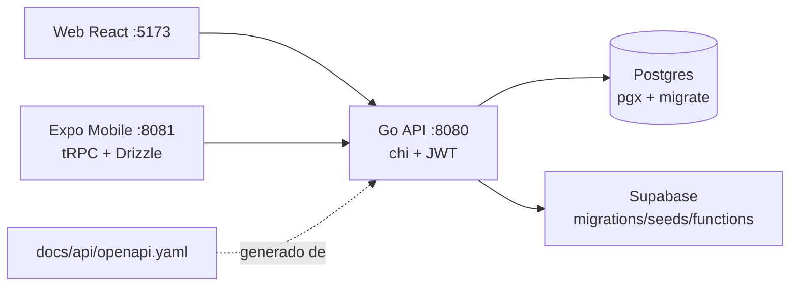

<div align="center">

# 📦 Movii — Plataforma Logística de Gestión de Envíos

**Monorepo full-stack: API en Go + web en React + app móvil en Expo + Supabase. Con CI por paquete y spec OpenAPI.**

**Full-stack logistics monorepo: Go API + React web + Expo mobile + Supabase. Per-package CI and OpenAPI spec.**

[](https://go.dev/)
[](https://reactjs.org/)
[](https://expo.dev/)
[](https://supabase.com/)
[](https://pnpm.io/)
[](https://github.com/features/actions)
[](#-autor-contacto-y-licencia)

**[📦 Repo](https://github.com/FelipeDiazAimar/Movii) · [🇬🇧 English version](README.en.md)**

> El proyecto más ambicioso del portfolio en arquitectura: 3 runtimes (Go + Node web + Expo), workspace pnpm, migraciones versionadas, OpenAPI real y 3 pipelines de CI. La app real vive en [`gestion-envios/`](gestion-envios/).

</div>

> **English TL;DR:** Logistics platform for shipment management: Go REST API (chi, pgx, JWT, golang-migrate) + React 19 + Vite web + Expo 57 mobile (Router, tRPC, Drizzle, NativeWind) + Supabase (migrations/seeds/functions). One-command setup (`node scripts/setup.mjs`) and dev (`node scripts/dev.mjs` lifts API+web+mobile with colored logs). OpenAPI spec in `docs/api/openapi.yaml`, CI per package. Full English docs in [README.en.md](README.en.md).

---

## 📑 Tabla de contenidos

1. [Qué es y qué problema resuelve](#-qué-es-y-qué-problema-resuelve)
2. [Demo](#-demo)
3. [Características](#-características)
4. [Arquitectura](#-arquitectura)
5. [Stack y librerías](#-stack-y-librerías)
6. [Estructura del monorepo](#-estructura-del-monorepo)
7. [Quick Start](#-quick-start)
8. [Instalación completa](#-instalación-completa)
9. [Variables de entorno](#-variables-de-entorno)
10. [Scripts](#-scripts)
11. [API](#-api)
12. [Base de datos y Supabase](#-base-de-datos-y-supabase)
13. [CI/CD](#-cicd)
14. [Deploy](#-deploy)
15. [Roadmap](#-roadmap)
16. [Troubleshooting](#-troubleshooting)
17. [Autor](#-autor-contacto-y-licencia)

---

## 💡 Qué es y qué problema resuelve

**Movii (`gestion-envios`)** es una plataforma logística para gestionar envíos de punta a punta: clientes que cotizan y siguen sus paquetes (web + móvil), operadores que gestionan estados y rutas, y una API única como fuente de verdad con Postgres.

| Antes | Ahora |
|---|---|
| Pedidos por teléfono/planilla | App web + móvil con seguimiento |
| Estados en la cabeza del repartidor | Máquina de estados en la API + migraciones versionadas |
| Cada cliente con su versión | Monorepo pnpm: un solo repo, CI por paquete |
| "La API hace X, creo" | `openapi.yaml` generado del código real (handlers + structs) |
| Deploys a mano | Workflows `api-ci / web-ci / mobile-ci` + Docker en `infra/` |

Proyecto de cursada con apuntes (`Apuntes/`: sprints, Scrum, ciclo de vida, SCM, calidad) y decisiones documentadas (`docs/decisions/`).

---

## 🚀 Demo

No hay demo pública desplegada (requiere Postgres + 3 servicios). Para verlo:

```bash
cd gestion-envios
npm run setup   # instala todo + crea .env desde .example
npm run dev     # API + web + mobile juntos
```

- API → http://localhost:8080 · Web → http://localhost:5173 · Mobile → Expo Go (QR, `:8081`).

---

## ✨ Características

| Pieza | Features |
|---|---|
| ⚡ API Go | REST con chi, auth JWT (`golang-jwt`), Postgres vía `pgx`, migraciones `golang-migrate`, CORS, UUIDs, tests `testify`, spec OpenAPI 3.0.3 |
| 🌐 Web | React 19 + Vite 6 + Router 7, TanStack Query, Axios, Zod, Tailwind 3, Vitest + Testing Library |
| 📱 Mobile | Expo 57 + expo-router, tRPC 11 (cliente + server), Drizzle ORM, NativeWind, notificaciones, QR dev, `db:push` |
| 🗄️ Supabase | `migrations/`, `seeds/`, `functions/` como alternativa/convivencia con Postgres propio |
| 🧰 DX | `setup.mjs`/`dev.mjs` con logs por color (`[API]`/`[WEB]`/`[MOBILE]`), `killTree` con `taskkill /T` en Windows para no dejar puertos huérfanos |

---

## 🏗️ Arquitectura



---

## 🛠️ Stack y librerías

**API** (`services/api/go.mod`, Go `1.27.1`): `chi/v5 5.3.2`, `cors 1.2.2`, `jwt/v5 5.3.1`, `migrate/v4 17.1`, `uuid 1.6.0`, `pgx/v5 5.10.0`, `godotenv 1.5.1`, `testify 1.11.1`, `crypto 0.26.0`.

**Web** (`apps/web`, `movii-web@1.0.0`): React `19.0`, Vite `6.0`, Router `7.1`, Query `5.62`, Axios `1.7.9`, Zod `3.24`, Tailwind `3.4`, TS `5.7`, Vitest `2.1`.

**Mobile** (`apps/mobile`): Expo `~57`, expo-router `~57`, tRPC `11.7.2`, Drizzle `0.44.7`, Query `5.90`, React Navigation 7, NativeWind, SecureStore, Notifications.

**Workspace:** `pnpm-workspace.yaml` (`apps/*`, `packages/*`), `pnpm-lock.yaml`, `packages/` compartidos.

---

## 📁 Estructura del monorepo

```
Movii/
├── gestion-envios/               # ← monorepo real
│   ├── package.json              # setup / dev (scripts/*.mjs)
│   ├── pnpm-workspace.yaml
│   ├── apps/
│   │   ├── web/                  # movii-web (Vite :5173, .env.example)
│   │   └── mobile/               # Expo (Metro :8081, tRPC, Drizzle)
│   ├── services/api/             # Go (cmd/, internal/, pkg/, migrations/, tests/)
│   ├── packages/                 # código compartido
│   ├── supabase/{functions,migrations,seeds}/
│   ├── infra/docker/             # Docker
│   ├── docs/{api/openapi.yaml,architecture,decisions}/
│   └── scripts/{setup.mjs,dev.mjs}
├── Apuntes/                      # material de cursada (sprints, Scrum, calidad…)
├── docs/superpowers/
└── .github/workflows/{api-ci,mobile-ci,web-ci}.yml
```

---

## ⚡ Quick Start

```bash
git clone https://github.com/FelipeDiazAimar/Movii.git
cd Movii/gestion-envios
node scripts/setup.mjs   # o npm run setup
node scripts/dev.mjs     # o npm run dev → API + web + mobile
```

Requisitos: Node 20+, **pnpm**, Go 1.27+, Postgres 14+ (o Supabase), Expo Go en el celu para mobile.

---

## 🔧 Instalación completa

```bash
cd gestion-envios
npm run setup
# 1. npm install en apps/web y apps/mobile
# 2. go mod download en services/api
# 3. crea .env desde cada .env.example (revisar valores)
npm run dev
# [API] go run ./cmd/api      → :8080
# [WEB] npm run dev (Vite)    → :5173
# [MOBILE] expo start --go    → :8081 (QR con pnpm qr)
```

**DB:** configurar `DATABASE_URL` en `services/api/.env` y correr migraciones (`migrate` o Supabase `migrations/` + `seeds/`).

---

## 🔑 Variables de entorno

| Dónde | Variable | Descripción |
|---|---|---|
| API | `DATABASE_URL` | Postgres (requerida; también en Secrets de GitHub Actions para CI) |
| API | `JWT_SECRET` | Firma de tokens (propio en CI si se usa) |
| API | `PORT` | Default `8080` |
| API | `CORS_ORIGINS` | Default `http://localhost:5173` |
| API | `ENV` | `development` |
| Web | `VITE_API_URL` | Default `http://localhost:8080` |
| Mobile | ver `apps/mobile/.env.example` | Claves Expo/tRPC/Drizzle |

---

## 📜 Scripts

| Dónde | Comando | Qué hace |
|---|---|---|
| Raíz | `npm run setup` | Install todo + `.env` iniciales |
| Raíz | `npm run dev` | API + web + mobile con logs por color |
| Web | `dev/build/preview/lint/test` | Vite + ESLint + Vitest (`tsc -b` en build) |
| Mobile | `dev` (server+metro), `android/ios/qr`, `db:push`, `check`, `lint` | Expo + Drizzle |
| API | `go run ./cmd/api`, `go test ./...`, `migrate` | Go estándar |

---

## 🔌 API

Spec: `gestion-envios/docs/api/openapi.yaml` (OpenAPI 3.0.3, generado de handlers/structs). Verlo en https://editor.swagger.io. Detalle de endpoints en `docs/api/README.md`.

---

## 🗄️ Base de datos y Supabase

- **Propia:** Postgres + `services/api/migrations/` (golang-migrate) + `pgx`.
- **Supabase:** `supabase/migrations/` + `seeds/` + `functions/` (convive como backend alternativo).
- Tests de API en `services/api/tests/` (`testify`).

---

## 🔄 CI/CD

| Workflow | Qué valida |
|---|---|
| `api-ci.yml` | Build + tests Go (usa `DATABASE_URL` de Secrets) |
| `web-ci.yml` | Lint + build web |
| `mobile-ci.yml` | Lint + checks Expo |

---

## ☁️ Deploy

- **API:** binario Go (`go build ./cmd/api`) o Docker (`infra/docker/`).
- **Web:** `pnpm build` → estático (Vercel/Netlify).
- **Mobile:** EAS Build / Expo.
- Sin URLs fijas en el repo: configurar dominios + `CORS_ORIGINS` + `VITE_API_URL` por entorno.

---

## 🗺️ Roadmap

- [x] Monorepo + setup/dev unificados + OpenAPI + 3 CIs
- [ ] Auth móvil con SecureStore contra la API Go
- [ ] Tracking en tiempo real (Supabase Realtime)
- [ ] Pagos y facturación del envío
- [ ] EAS Update + despliegues por entorno

---

## ❓ Troubleshooting

| Síntoma | Solución |
|---|---|
| Puerto retenido tras Ctrl+C (Windows) | `dev.mjs` ya usa `taskkill /T`; si queda algo: `taskkill /F /IM api.exe` / liberar `:8080/:5173/:8081` |
| Mobile no conecta a la API | Misma red Wi-Fi + `VITE_API_URL`/IP LAN en vez de localhost |
| `DATABASE_URL` en CI | Agregarla en GitHub → Settings → Secrets → Actions |
| pnpm vs npm | El workspace es pnpm; no mezclar lockfiles |

---

## 👤 Autor, contacto y licencia

**Felipe Diaz Aimar** — Full-stack (Go, React, Expo, Postgres).
- 💼 LinkedIn: https://www.linkedin.com/in/felipe-aimar/
- 📧 Email: felipediazaimar@gmail.com
- 🐙 GitHub: https://github.com/FelipeDiazAimar

Proyecto académico adaptado a portfolio. Todos los derechos reservados.

[(volver arriba)](#-movii--plataforma-logística-de-gestión-de-envíos)

<details>
<summary><b>🇬🇧 English summary (full version in README.en.md)</b></summary>

Logistics monorepo (Go API + React web + Expo mobile + Supabase) with one-command setup/dev, real OpenAPI spec and per-package CI. Course project turned portfolio piece.

</details>
